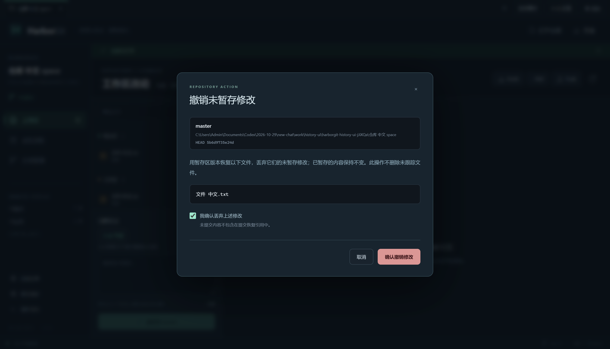
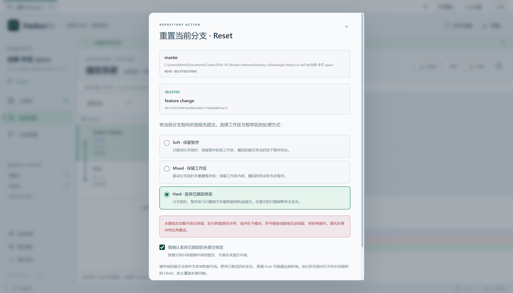
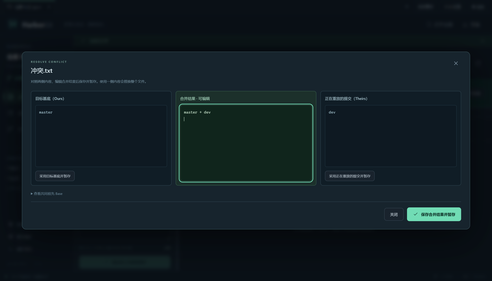

# 变基与回滚（v1.4.0）

本版本依据本机 IDEA Git 插件的注册、资源和选定 JVM 字节码研究，独立编写 Rebase、文件恢复、Revert 与 Reset。实际执行仍为本机 Git CLI，无需 IDEA。IDEA 证据与客户端测试是两套记录，见 [增量调查报告](IDEA-HISTORY-ANALYSIS.md)。

## 选择合适的操作

| 目的 | 操作入口 | 实际影响 |
|---|---|---|
| 把当前分支的提交重放到另一个分支之上 | 分支管理 → 将当前分支变基到目标分支 | 改写被重放提交的 ID；当前分支继续使用原名称 |
| 丢弃某个文件新的未暂存修改 | 工作区文件旁的撤销按钮，或文件 Diff 操作栏 | 从 index 恢复工作区；暂存区保留 |
| 丢弃某个文件已暂存及未暂存的修改 | 暂存文件旁的撤销按钮 | 从 HEAD 恢复该文件的 index 与工作区 |
| 用一个新提交抵消旧提交 | 提交历史 → 选中提交 → Revert 所选提交 | 创建反向提交，原提交仍在历史中 |
| 撤回当前分支最近若干提交，自己决定如何保留文件 | 提交历史 → 选中祖先提交 → Reset | 按 Soft/Mixed/Hard 更新当前分支、index、工作区 |

取消暂存仍保留文件内容，与“撤销修改”不同。文件撤销必须勾选确认；不会删除未跟踪文件。新增且 HEAD 没有记录的文件不执行删除式回滚，需先取消暂存并自行处理。

## 变基

1. 切到需要重放提交的本地分支，例如 dev。
2. 打开“分支管理”，点击“将当前分支变基到目标分支”，选择 master 或已有远程分支。也可使用分支行中的变基入口。远程分支需要先 Fetch。
3. 检查方向 **dev → master**。需要重建合并结构时勾选“保留合并结构”；未勾选使用普通非交互变基。
4. 点击“开始变基”。成功后刷新历史；发生冲突则保留变基状态并显示控制条。

变基前要求工作区、暂存区及普通未跟踪内容已经处理；当前不会自动 stash/shelf。与操作路径无关的 ignored 目录（例如 node_modules）可以保留。如果历史中某个中间提交的路径会覆盖 ignored 内容，会在开始前拒绝，并保留文件。

控制条提供：

- **继续变基**：解决并暂存冲突后继续；后续提交仍可能再次产生冲突。
- **跳过当前提交**：确认后丢弃当前重放步骤，继续后面的提交。不是“忽略冲突并保留此提交”。
- **中止变基**：确认后让 Git 恢复变基前的分支和提交；本次冲突解决编辑会丢失。

应用关闭再打开仓库后，会从该 worktree 的 rebase 状态恢复这些入口。兼容普通 `rebase-merge`、`rebase-apply` 状态和 linked worktree；不把另一工作区的状态混到当前项目。

变基冲突中，Git 的 **Ours 是目标基底/已经重放的内容，Theirs 是正在重放的原分支提交**。编辑器据此显示“目标基底”和“正在重放的提交”，避免沿用普通合并的“当前/传入分支”解释。解决后使用上方“继续变基”，普通提交按钮在过程中禁用。

变基不移动目标分支。显式关闭 `rebase.updateRefs`、自动 stash 和自动 squash，避免用户全局设置额外改写其他分支或启动未选择的流程。普通 Push 仍不强推：改写已推送历史后可能被远程拒绝，需要先与协作者协调。

## Revert：创建新的反向提交

在“提交历史”选择当前分支历史中的提交，再点击“Revert 所选提交”。确认后立即运行 `git revert --no-edit`，无冲突时创建新提交；不会删除原提交。

合并提交需要选择主线父提交。默认父提交 1，通常是原合并时所在分支；必须按实际合并方向核对。该功能是 HarborGit 的扩展：所分析 IDEA 版本的 Log Revert 会禁用 merge commit，而 HarborGit 通过显式 mainline 支持它。

发生冲突时显示“反向提交进行中”。解决并暂存后点击“继续反向提交”，也可确认“中止反向提交”。普通提交在该过程中禁用。重启后同样恢复进行中状态。

Revert 要求干净的已提交本地分支；拒绝对不属于当前 HEAD 祖先历史的提交执行反向提交。单次入口只处理一个提交，不是批量反向提交。

## Reset：明确选择保留范围

在提交历史选中当前 HEAD 的祖先提交，点击“Reset 当前分支到所选提交”。默认选择 Mixed：

| 模式 | 分支/HEAD | 暂存区 | 工作区 |
|---|---|---|---|
| Soft | 移到目标提交 | 保留原 index | 保留原文件内容 |
| Mixed | 移到目标提交 | 恢复为目标提交 | 保留原文件内容 |
| Hard | 移到目标提交 | 恢复为目标提交 | 恢复目标提交的已跟踪文件，丢弃其未提交改动 |

Soft/Mixed 可以保留现有未提交文件内容；Hard 需要额外勾选丢弃确认。无关的未跟踪、ignored 文件会保留；如果它们与恢复路径相同，或存在目录祖先/后代碰撞，则拒绝 Hard。不会用 `git clean` 清空目录。

Reset 的 UI 面向已提交的正常分支；目标限制在当前历史，避免在全分支图中误选另一个分支的独有提交。对话框固定打开时的 HEAD，执行前再核验；检测到外部改变就拒绝，需要重新打开确认。执行期间仍应避免用外部工具同时改写同一仓库。

## 文件恢复

同一文件可有两个独立版本。例：HEAD 为 A，暂存区为 B，工作区为 C。

- 工作区“撤销未暂存修改”之后：HEAD=A、暂存区=B、工作区=B。
- 暂存区“撤销暂存及工作区修改”之后：HEAD=A、暂存区=A、工作区=A。
- 原有“取消暂存”之后：HEAD=A、暂存区=A、工作区=C。

确认窗口列出文件路径，重命名时列出两端。通过 NUL pathspec 和 literal 路径处理中文、空格、方括号及前导 `-`。只恢复所选已跟踪文件，不把相邻文件或通配符匹配到的其他文件一起撤销。新增文件、未跟踪文件、目录联接等无法安全处理的情况会拒绝，保留内容并解释原因。

## 操作前提交的恢复引用

每次启动这些操作前，会将原 HEAD 记录为本地 Git 引用：

```text
refs/harborgit/backups/<时间戳-唯一标识>
```

界面显示最近一次引用。它保留**已提交历史**，不是未提交文件的备份；Hard、文件撤销或中止时丢弃的编辑不能靠这个引用找回。

如需查看旧提交，可以在分支管理“创建分支”的起点栏粘贴该引用，创建恢复分支；或在目标仓库中执行：

```powershell
git for-each-ref refs/harborgit/backups/ --format="%(refname) %(objectname:short)"
git branch recovery-before-reset refs/harborgit/backups/这里替换为实际引用
```

这些引用不会被默认分支/标签历史查询混入，也不自动推送。当前没有自动清理或恢复引用管理面板。

## 调用、状态及保护

所有操作通过主进程白名单和每项目队列执行；Git 使用参数数组、`shell:false` 和无交互编辑器。保留进度、退出码、stderr、取消和超时处理。取消进程不等于中止变基，需要刷新状态再选择 Continue/Abort。

持续状态读取 per-worktree Git 目录；冲突不是“完全失败且无变化”，客户端会刷新并显示恢复入口。Git hook/签名或取消等非冲突失败也会保留错误及实际仓库状态。对未支持的外部 am/cherry-pick/sequencer/bisect，会阻止干扰它们的历史写操作，需在外部完成或中止。

开始和恢复操作前会验证所涉 index/提交树及历史中间路径，保护未跟踪/ignored 碰撞；对涉及子模块、符号链接或目录联接的这类历史操作采取拒绝策略，避免在界面里猜测其恢复范围。现有普通 Git 功能仍按原范围工作。

## 分析所得与独立设计

已从 IDEA 包确认：普通 Rebase 及 Continue/Skip/Abort 的分离状态；工作区/index/HEAD 的不同恢复基线；Revert 正常路径创建新提交；Reset 有 Soft/Mixed/Hard/Keep 及默认 Mixed。证据定位、REA ID、JAR/class 哈希、字节码方法与 offset 均在 [IDEA-HISTORY-ANALYSIS.md](IDEA-HISTORY-ANALYSIS.md)。REA 不支持独立 JVM class，本次复用已验证的 JAR inventory，再用本机 javap 补充语义分析，没有伪称动态执行 IDEA 写操作。

HarborGit 自行设计并实现了 UI、确认窗口、CLI 协议、状态读取、任务保护、原 HEAD 恢复引用和测试。`git restore` 是客户端自主选用的现代路径恢复命令，IDEA 选定路径用的是 checkout；合并 Revert mainline 也是扩展。没有加载或复制 JetBrains 插件/界面代码。

语义参考 Git 官方文档：[rebase](https://git-scm.com/docs/git-rebase)、[revert](https://git-scm.com/docs/git-revert)、[reset](https://git-scm.com/docs/git-reset)、[restore](https://git-scm.com/docs/git-restore)。

## 验证记录与边界

所有 Git 写入仅发生在 `work/` 下新建的专用仓库。远程回归仅使用本地裸仓库或 loopback HTTP fixture，没有推送用户真实仓库，没有发布 GitHub Release。

- [完整后端最终结果](verification-v1.4-backend-final.txt)：51/51 通过，含普通变基、冲突重启/继续/跳过/中止、保留合并结构、linked worktree、原分支保护、Revert 普通/merge 与冲突恢复、Reset 三模式、过期 HEAD、路径字面量、重命名、未跟踪/ignored 碰撞和联接目录防护，以及原 Git/AI/更新回归。
- [完整界面最终结果](verification-v1.4-ui-final.txt)：13 项通过、1 项安装版专用用例按条件跳过。真实 Electron 中操作文件恢复、Revert、Mixed/Hard Reset、变基冲突后重启与继续，并回归原有功能。
- [实际安装后界面验证](verification-v1.4.0-installed-ui.txt)、[安装与卸载](verification-v1.4.0-installer.json)：5/5 通过，使用独立 QA 身份安装相同 EXE/ASAR 载荷，覆盖安装版更新入口与设置恢复、原有提交闭环及三组新增历史 UI 流程。明暗主题均有实际截图。QA 的独立程序名、注册项及快捷方式用于保护电脑上正在使用的正式 HarborGit，不等同于执行正式应用覆盖升级。
- [更新附件核验](verification-v1.4.0-update-metadata.json)：实际 Setup 的 SHA-512、大小和包内 GitHub 来源配置与 latest.yml 相符，blockmap 存在。应用/安装器图标见 [PE 资源核验](verification-v1.4.0-icons.json)。
- [生产构建](verification-v1.4-build.txt)；Windows 安装包和更新元数据另见交付清单。

首轮界面启动因测试传入的 Windows 目录尾反斜杠失败，已规范化路径；Revert 的测试预期按明确的最终确认文案修正。并行回归发现旧远程测试将仓库放在 Playwright 会自动清理的 test-results，已移到独立 work/remote-integration，避免测试互相删除数据。以上是测试工具调整，未删除用户仓库。保护检查也经过补充测试：普通 node_modules 不误拦，而中间提交曾触及的 ignored 路径仍受到保护。

未实现：交互式 rebase、提交排序/squash/fixup、`--onto`、root rebase、自动 stash/shelf、Reset Keep、多仓库联动回滚、批量 Revert、行级/hunk 回滚、未提交内容自动备份与恢复引用管理面板。未进行大型仓库性能基准、真实签名工具及所有外部 hooks 的兼容性测试；macOS 打包配置保留，新增界面与 Git 流程尚未在 Mac 真机验证。

复现：`npm run test:history`、`npm test`、构建后 `npm run test:ui`。源码启动 `npm start`；生成安装包 `npm run dist:setup`；核对更新附件 `npm run verify:updates`。本次没有推送源码、tag 或 GitHub Release。






