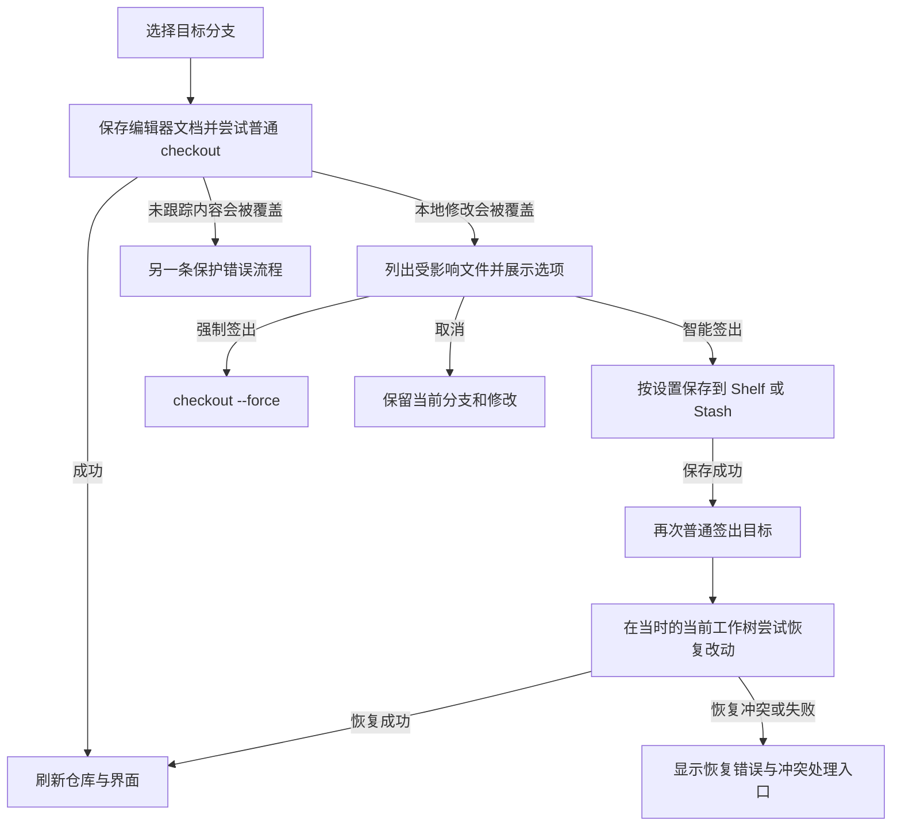

# IDEA 智能签出分析

分析日期：2026-11-13（Asia/Shanghai）。目标为本机 IntelliJ IDEA 2026.1.3 / IU-261.25134.95。结论来自已安装 JAR、资源与 JVM 字节码；本轮没有启动 IDEA、点击实际签出、操作真实仓库或修改 HarborGit 功能和版本。

**结论：IDEA 的“智能签出”在普通签出遇到本地修改覆盖保护后，提供保存本地修改、签出目标、再尝试恢复修改的工作流。成功签出 master 后，恢复发生在 master 当前工作树，不会自动返回 dev 恢复。恢复可能产生冲突。**

## 操作入口 → 状态变化 → 调用 → 结果

下表“已确认”指本机构建的静态注册 / 方法调用 / 参数和分支，不代表本轮实际执行观察。`+N` 是该方法内十进制 JVM 指令偏移，不是源代码行号或文件偏移。

| 阶段 | 已确认的行为 | 证据 |
| --- | --- | --- |
| 选择引用并签出 | `GitCheckoutAction.actionPerformed` +75 调 GitBrancher.checkout；实现排队后台任务 `$4`，该任务 +28 调 GitBranchWorker.checkout。Worker +22…+47 构造并执行 GitCheckoutOperation。 | [引用动作](evidence/smart-checkout-2026-11-13/javap/git4idea.actions.ref.GitCheckoutAction.txt)、[Brancher](evidence/smart-checkout-2026-11-13/javap/git4idea.branch.GitBrancherImpl.txt)、[后台任务](evidence/smart-checkout-2026-11-13/javap/git4idea.branch.GitBrancherImpl$4.txt)、[Worker](evidence/smart-checkout-2026-11-13/javap/git4idea.branch.GitBranchWorker.txt)。 |
| 先尝试普通签出 | GitCheckoutOperation.doExecute +0 保存编辑器文档；+174 调 Git.checkout。本地修改覆盖 detector 检测到错误时，+296 转 smartCheckoutOrNotify。 | [CheckoutOperation](evidence/javap/git4idea.branch.GitCheckoutOperation.txt)，[检测器](evidence/smart-checkout-2026-11-13/javap/git4idea.commands.GitLocalChangesWouldBeOverwrittenDetector.txt)。 |
| 展示阻塞文件及选择 | smartCheckoutOrNotify +46 收集受影响仓库及 Change；+118 调 showSmartOperationDialog。Dialog 展示 Change 浏览器，缺少 Change 时退回路径浏览器。选项对应 SMART、FORCE、取消。 | [Dialog](evidence/smart-checkout-2026-11-13/javap/git4idea.branch.GitSmartOperationDialog.txt)、[UiHandler](evidence/smart-checkout-2026-11-13/javap/git4idea.branch.GitBranchUiHandlerImpl.txt)、[资源原行 426–433 / 1337–1338](evidence/smart-checkout-2026-11-13/vcs-git-frontend.jar-resource-excerpts.json)。 |
| 智能签出 | SMART 分支 +155 调 smartCheckout。该方法 +54 读取 getSaveChangesPolicy，+59…+103 构造 GitPreservingProcess，+110 调无参 execute。传入的是受影响仓库 roots，不是仅传弹窗中列出的几个文件。 | [CheckoutOperation 的方法选段](evidence/smart-checkout-2026-11-13/checkout-method-excerpts.json)，[受影响仓库收集](evidence/smart-checkout-2026-11-13/javap/git4idea.branch.GitBranchOperation.txt) getConflictingRepositoriesAndAffectedChanges。 |
| 保存后再次签出 | smartCheckout 的 lambda +6 传 false，+9 调 checkoutOrNotify。该方法 +111 调 Git.checkout。GitImpl 只有 force=true 才在 +77 添加 --force，因此智能分支不是强制覆盖。 | [CheckoutOperation](evidence/javap/git4idea.branch.GitCheckoutOperation.txt) lambda$smartCheckout$6、checkoutOrNotify；[GitImpl](evidence/javap/git4idea.commands.GitImpl.txt) checkout。 |
| 恢复及刷新 | wrapper 保存成功才运行签出。正常退出和异常 finally 均按当前调用的默认恢复条件尝试 saver.load。签出成功后更新仓库、刷新 VFS；恢复失败另有通知和冲突入口。 | [保存/恢复子链的精确行号与偏移](evidence/smart-checkout-2026-11-13/saver/findings.md)。 |

这条流程可以概括为：

图是对静态调用链的归纳，不是录制的运行 trace。尤其是 F 失败时，G 仍可能执行，恢复位置取决于当时实际工作树；多仓库操作的最终分支可能不同。

## Shelf / Stash 如何保存和恢复

已确认的细节及复用输出哈希集中在 [saver/findings.md](evidence/smart-checkout-2026-11-13/saver/findings.md) 和 [saver/provenance.json](evidence/smart-checkout-2026-11-13/saver/provenance.json)。

- **保存方式由设置决定。** GitChangesSaver.getSaver 按 policy 选择 GitShelveChangesSaver 或 GitStashChangesSaver。GitVcsOptions 构造器把默认值初始化为 SHELVE；本轮未读取用户的实际设置。
- **保存范围按仓库 root。** Stash 对传入 roots 逐仓库调用 stashSave，没有只保存弹窗冲突文件的 pathspec；Shelf 按 root 过滤已知 Change / changelist 并保存。弹窗中的阻塞路径不等同于完整保存文件清单。
- **Stash 自动保存参数是 `stash push -m <message>`。** 这条入口没有 `-u`、`--include-untracked` 或 `--all`，不能说它保证带走所有未跟踪或忽略内容。
- **Stash 恢复参数是 `stash pop [--index]`。** 只有启用 staging commit mode 时添加 --index；恢复仍可能失败，不能承诺始终原样还原 staged / unstaged 划分。此调用链未把所保存的 OID 显式放到 pop 参数中，保存 hash 另用于刷新变更。
- **Shelf 是 IDE 的补丁 / 变更列表机制。** 保存后清理已保存的修改，再通过系统 Unshelve 恢复。所选代码没有证明任意 untracked / ignored 文件或原 index tree 都有完整快照保证。
- **保存失败就不继续签出。** GitPreservingProcess 的保存错误会显示通知，跳过操作。签出调用的是默认 execute(null)：保存成功后，即使签出报告失败或 runnable 抛异常，也会尝试恢复到当时的工作树。

## 恢复冲突与其他边界

**已确认事实：** GitStashOperations.unstash 分别检测 index conflict、merge conflict、未跟踪覆盖和本地修改覆盖。merge conflict 进入 GitConflictResolver；未解决通知提供 Show Stash、Resolve Conflicts 入口。GitStashChangesSaver.load 丢弃 unstash 返回的 boolean，因此“签出操作成功”和“未提交改动完整恢复成功”需要分开判断。Shelf 系统恢复遇到 ABORT 时停止后续列表。

**已确认事实：** 初次 checkout 的未跟踪覆盖检测器走 fatalUntrackedFilesError（doExecute +311…+332），与“已跟踪的本地改动会被覆盖”触发智能签出的分支不同。不能把所有签出错误都转成自动保存后强行重试。

**语义推断：** 根据 Git pop 的通常行为，恢复成功可移除 Stash 条目，合并冲突时条目通常保留；本轮没有执行 pop 来观察最终 Stash 栈。所选合并冲突分支在 resolver 返回后没有显式调用 stash drop。它不等同于 HarborGit 目前保留专用 WIP ref 和 Stash 条目的设计。

**未确认：** 用户当前 Shelf / Stash 设置、是否启用 staging area、实际中文语言包文案与实时窗口、二进制 / rename / Shelf patch engine 的全部边界、并发改变 Stash 栈和崩溃恢复的所有结果。本轮没有检查或读取用户真实 Stash、配置文件内容或 application-dev.yml。

## 对你这次 dev → master 的含义

你贴出的 checkout 错误属于“本地已跟踪改动会被覆盖”，正是上述 smartCheckoutOrNotify 分支要处理的情况。

若在 IDEA 选择智能签出，通常流程是保存受影响仓库的本地修改，再签出 master，并尝试将保存的修改恢复到 master 工作区。**恢复成功后，这些修改仍是未提交修改，只是当前分支已经是 master。** 若 application-dev.yml 的同一部分与 master 版本冲突，就进入恢复冲突处理；不保证自动选出正确配置值。

如果你的意图是“把改动留给 dev，切到干净的 master”，那是保存后暂不在 master 恢复的另一种行为。应与“把修改一起带到 master”的智能签出明确区分。

## 当前 HarborGit 的差异与独立设计建议

当前 [git-service.ts](../src/main/git-service.ts) 的 `case 'checkout'` 只检查分支后调用普通 `git switch <branch>` 或 `git switch --track <remote>`，没有接入保存 / 签出 / 恢复的 wrapper。这解释了当前按钮只显示 Git 错误。变基完成后的“未提交改动恢复已结束”是上一轮流程状态，不会自动为下一次切换提供智能签出。

如果后续实现，可自行设计为：遇到覆盖保护时展示受影响路径与目标分支，提供明确的“保存并携带修改切换”选项；签出与恢复分成独立状态，恢复冲突进入普通文件冲突处理，备份保留。保存后留在源分支的修改与携带到目标分支的修改应分开表达。这里是实现建议，**本轮没有加入这些功能，也没有改变 Git 命令行为或应用版本。**

## 身份、REA 与格式限制

安装目录：`D:\Program Files\JetBrains\IntelliJ IDEA 2026.1.3`，构建 IU-261.25134.95。

- vcs-git.jar SHA-256：`6dee7a6363454456b7b187c3c9682b01d78f62b50840b1f571b6d5afdf4e5be0`。
- vcs-git-frontend.jar SHA-256：`0e5135d36bcb94fbf4f5773bb123bd2f964566b872988bee6d5cfc6a0de75a17`。
- [JAR 身份](evidence/smart-checkout-2026-11-13/source-identities.json)、[新增反汇编 provenance](evidence/smart-checkout-2026-11-13/javap-provenance.json)、[复用校验](evidence/smart-checkout-2026-11-13/reused-bytecode.json)、[资源 member 身份](evidence/smart-checkout-2026-11-13/resource-identities.json)。

REA 会话起始无打开目标，复用先前完整 JAR 库存 `ev_b3436a50eea22fcaae9597c602b3ada48b0592bf729014c1efc1ffce19e530e3`，从既有 bundle 精确认证 5 个 class occurrence，全部 hash_status=verified。此次返回 Evidence 为 `ev_784fd9b28e82222af4fc1aac4cf68a12e8163d89640122ba090255aeb92966da`，见 [完整调用返回](evidence/smart-checkout-2026-11-13/rea-selected-occurrences.json) 和 [导出 bundle](evidence/smart-checkout-2026-11-13/rea-view-bundle.json)。库存只支持成员存在与身份，不能据此声称观察了执行。

REA 的既有 [JVM .class 格式限制](evidence/rea-class-format-limitation.json) 仍适用，没有重复失败尝试。JVM 方法改用现有 JDK 21 javap，打包资源改用 Python zipfile 与 properties 文本解析。字节码反汇编不是 IDEA Java 原始源码。本轮没有安装工具、修复 REA 配置、做 Git 写入测试或重新打包应用。
