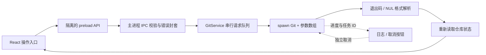

# HarborGit 实现说明

## 数据与执行路径

- `src/shared/types.ts`：类型化请求 / 响应、仓库快照与活动事件。
- `src/main/git-service.ts`：Git 调用的唯一边界、输入校验、任务生命周期和业务操作。
- `src/main/main.ts`：Windows 窗口、IPC、目录对话框与最近仓库。
- `src/main/preload.ts`：有限的桥接接口，不暴露 ipcRenderer 本身。
- `src/renderer/App.tsx`：仓库操作与状态、历史 / 分支 / 冲突交互、异步过期结果保护。
- `src/renderer/styles.css`：独立视觉设计，支持窗口缩放，最小窗口 1100×720。

## 操作到 Git 的映射

以下是 HarborGit 自己的调用设计，不代表 IDEA 的实际参数。通用前缀为 `--no-pager --literal-pathspecs -c core.quotepath=false -c color.ui=false`；cwd 始终为当前已打开仓库或显式 clone 父目录。

| 操作 | 主要命令 / 内容路径 | 完成后 |
|---|---|---|
| 打开 | `rev-parse --show-toplevel`，根路径 realpath | 设置当前仓库，读取完整快照；失败保留原仓库 |
| 克隆 | `clone --progress -- URL destination` | 打开新仓库；目标限空目录或不存在目录 |
| 刷新 | `status --porcelain=v2 -z --branch --untracked-files=all`；`rev-parse --git-path MERGE_HEAD`；读取本机提交身份 | 解析分支、上游、双维文件状态、merge 状态 |
| 工作区 Diff | `diff --no-ext-diff --no-textconv ... -- path`；未跟踪普通文件按新增构造预览 | 统一差异视图 |
| 暂存区 Diff | `diff --cached ... -- path` | 相对 HEAD；支持 unborn 初始暂存 |
| 暂存 | `add -A --pathspec-from-file=- --pathspec-file-nul`，stdin 传 NUL 路径 | 重读快照 |
| 取消暂存 | `reset --quiet HEAD --pathspec-from-file=- --pathspec-file-nul`；unborn 使用 `rm --cached` | 保留工作区内容，重读快照 |
| 提交 | `commit --file=-`，消息走 stdin | 校验 unresolved / 暂存内容，成功后重读快照 |
| 历史 | `log -z --skip=N --max-count=100 --format=... HEAD` | NUL 字段解析；消息不使用行切分 |
| 提交文件 / Diff | first parent 与提交 `diff --name-status -z -M` / `diff`；root 用 `diff-tree --root` / `show --root` | 支持 rename、初始提交、merge first parent |
| 分支 | `for-each-ref`；`check-ref-format --branch`；`switch -c` / `switch`；`branch -d` | 校验存在性；不强删；刷新分支 / 快照 |
| Fetch | `fetch --progress --prune -- remote` | 更新 refs，再取快照 |
| Pull | `pull --ff-only --no-rebase --progress -- remote branch` | 分叉时拒绝，不自动 rebase / merge |
| Push | `push --progress --set-upstream -- remote HEAD:refs/heads/branch` | 明确只推送当前 HEAD，不依赖 push.default 批量推分支 |
| Merge | `merge --no-edit -- branch`，要求当前干净 | 冲突返回错误后仍刷新，显示进行中合并 |
| 冲突内容 | `show :1:path` / `:2:path` / `:3:path`，不存在一侧为 null | Base / Ours / Theirs 与工作区文本 |
| 完整采用一侧 | `ls-files --unmerged -z` 判定一侧存在；`checkout --ours/--theirs -- path` + `add`；删除一侧用 `rm` | 保留原始文件字节并标记解决 |
| 手工解决 | 文件边界检查；写入 UTF-8；`add -- path` | 拒绝二进制、截断及冲突标记；已暂存后提交 |
| 中止 | `merge --abort` | 刷新真实状态 |
| 身份 | `config --local user.name/email value` | 只改当前仓库身份 |

## 状态与失败

仓库快照不是按按钮预测的结果。普通文件同时保存 index 和 worktree 状态，rename 记录原路径；冲突通过 porcelain v2 的 `u` 记录标识。相同路径既可能有 staged 版本，又有后续未暂存版本。UI 分组基于这两个维度，Diff 范围也随分组选择。

请求队列涵盖读取和写入，避免一个窗口内出现 index 竞争；不能阻止外部程序同时操作仓库，Git 的锁和返回码仍是最终依据。窗口聚焦 / 手工刷新重新读取外部更改。Diff 与历史详情使用递增 epoch，防止快速切换后旧异步结果覆盖新选择。

失败封套含 message、command、stdout、stderr、exit code 和 cancelled。后台启动不等于成功，只有退出码符合该命令预期才继续；允许的非零码仅用于不存在的配置、unborn HEAD 或缺失冲突 stage 等明确读取分支。HTTP URL 中的认证信息在日志展示前遮盖。

Windows 取消使用参数数组启动 `taskkill /PID /T /F`。MSYS 子进程可能保留管道句柄，因此停止后在 Git 的 exit 事件清理管道并结束任务；正常命令继续等待 close 以完整读取输出。超时走相同流程，取消后不会清理 / 删除未知 Git lock，也不承诺事务回滚。

## 外部文档

官方 [Git status 文档](https://git-scm.com/docs/git-status) 说明 NUL 分隔与 index / worktree 状态。HarborGit 采用可机器解析的 porcelain v2；IDEA 被选定的字节码使用的具体 status 参数另见调查报告，二者不混同。

Electron 的隔离、sandbox、有限 IPC 与禁止新窗口遵循 [Electron security 文档](https://www.electronjs.org/docs/latest/tutorial/security)。这里是自主工程设计依据，不是 IDEA 分析证据。
