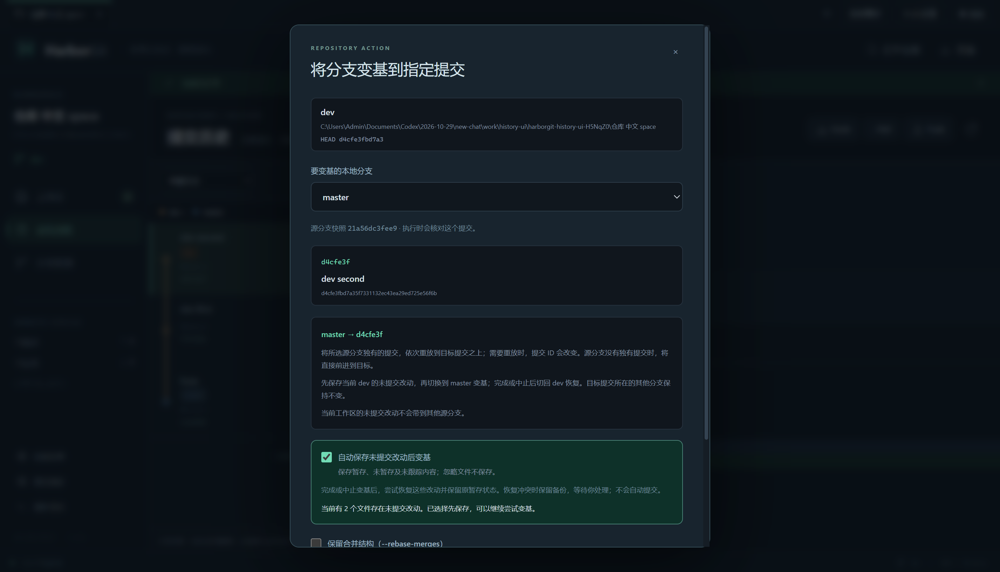
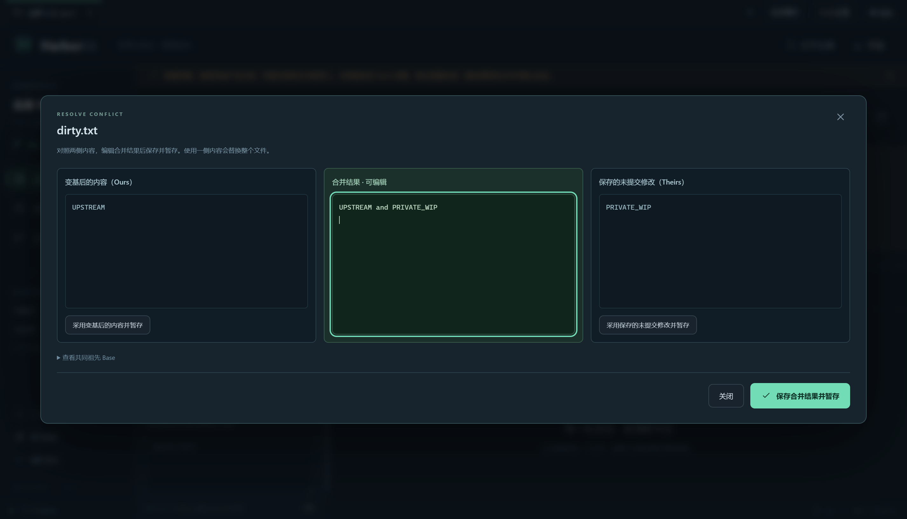

# 有未提交改动时变基（v1.6.0）

Git 重放提交前需要先处理暂存区与工作树中的已跟踪修改；客户端可以先保存改动、变基后再恢复。HarborGit 的旧版提示是一项保守限制；本版增加显式自动保存流程，默认仍不代替用户保存。

## 操作

1. 从分支管理打开变基，或在提交历史选中提交后点击“将分支变基到所选提交”。
2. 选择要变基的本地分支与目标。当前有未提交改动时，勾选“自动保存未提交改动后变基”。
3. 点击“开始变基”。程序保存暂存、未暂存及普通未跟踪文件，再对已提交历史执行变基。
4. 变基冲突时先解决并暂存，再继续；也可跳过当前提交或中止。此时原未提交改动继续留在备份中。
5. 变基完成或中止后，程序尝试恢复原改动与暂存状态；如恢复冲突，处理现有文件并暂存冲突，再点击“结束恢复并保留备份”。不会自动提交你的 WIP。

例如当前 dev 有未提交修改，而 master 需要变基到 dev 的第二个提交：先保存 dev 的 WIP，切换并变基 master，结束后切回 dev 恢复其 WIP。master 没有独有提交时前进到所选提交；有独有提交时重放其提交，结果可能超过所选提交。dev 的已提交引用不因本次 master 变基而改变。

## 失败、取消与恢复

“变基未提交改动备份”区域展示专用引用及恢复状态。关闭应用或取消任务不会删除备份；重新打开项目仅找回记录，不盲目重复应用。

- **变基暂停**：先继续、跳过或中止变基；暂不恢复原 WIP。
- **等待恢复**：检查工作区及分支后，使用“恢复保存的改动”。外部分支变化、Git 锁和同名未跟踪文件可能阻止恢复。
- **恢复出现冲突**：Ours 是变基后的内容，Theirs 是保存的未提交修改。处理现有文件、暂存冲突，再确认结束恢复。
- **保留暂存状态失败且尚未部分写入**：可以明确选择“恢复为未暂存修改”。该操作不保留原 staged / unstaged 划分；备份中仍有原 index 版本。普通已跟踪文件的修改恢复到工作区；Git 可能仍将原暂存的新增文件放入暂存区，恢复后请检查文件状态。已经部分应用时禁止自动重试，避免重复写入。
- **确认结束恢复**：表示用户已检查并处理，不承诺程序自动还原了全部内容；不生成提交，也不删除备份。

待恢复时暂时阻止普通提交、切换分支、Reset、合并和远程写操作；保留查看、暂存、取消暂存、冲突处理、变基继续/中止与恢复入口。手工处理未跟踪同名文件时，请先在仓库外另存所需内容，再结束恢复或在确认干净后恢复；不要直接清理备份。

## 保存位置和范围

实现使用 `git stash push --include-untracked --message <唯一标识>`，并固定到 `refs/harborgit/wip/<UUID>`。不依赖当前 Stash 栈顶恢复，也不自动执行 pop、drop 或删除专用引用。已有用户 Stash 保留。

每个 worktree 的 Git 元数据目录（由 `git rev-parse --absolute-git-dir` 获取）保存 `harborgit-rebase-save.json`，记录原分支、原 HEAD、变基源分支、Stash OID 与阶段。先写入保存意图，再保存文件；中断时用唯一标识和父提交验证归属。恢复前持久记录尝试状态，不能证明未部分写入时要求手工检查。正常恢复调用 `git stash apply --index <专用引用>`。

`refs/harborgit/backups/...` 只备份已提交历史；`refs/harborgit/wip/...` 才包含未提交内容。自动保存不包含 ignored 文件。保存和恢复前检查相关路径、被忽略内容及中间提交；子模块、符号链接、联接目录和特殊索引模式等暂不支持自动流程。备份占用本地空间，生命周期由用户管理。

本机 Git for Windows 在全局 `--literal-pathspecs` 下执行 `stash push -u` 会保存未跟踪对象却留下原文件。该路径在专用仓库复现后，保存和恢复 Stash 子命令使用 `--no-literal-pathspecs`，让 Git 处理内部生成的路径规则；它们不接收用户路径参数。其他文件操作继续使用字面路径参数及参数数组，所有命令均 `shell: false`。

## 分析与独立设计

[REA / javap 静态分析](IDEA-REBASE-WIP-ANALYSIS.md) 确认 IDEA 有“保存改动→变基→按结果恢复”的流程。IDEA 本版默认设置初始化为 Shelf，所观察自动 Stash 路径未加 `-u`，仅在 staging commit mode 恢复时加 `--index`；这些不是对用户当前配置或运行结果的断言。REA 不支持本次独立 JVM class 分析，改用 JAR 证据库存及现有 JDK `javap`，见报告中的格式边界和原始证据。

HarborGit 的显式选择、包含普通未跟踪文件、持久 WIP 引用、原分支恢复、保留备份和避免重复应用，是独立编写的产品与安全策略。没有复制 IDEA 实现，也没有宣称它们与 IDEA 逐项一致。Shelf、高级 `--onto`、交互式变基及任意特殊文件系统组合尚未提供；实际断电和所有外部并发写入情形尚未穷尽验证。

启动：`npm ci` 后 `npm start`；打包：`npm run dist:setup`。验证结果见 [本版交付说明](RELEASE-1.6.0.md)。

实现位置：[Git 服务与持久恢复流程](../src/main/git-service.ts)、[确认对话框](../src/renderer/RepositoryActionDialog.tsx)、[恢复状态区域](../src/renderer/RebaseSavedChangesBanner.tsx)、[数据保全测试](../tests/rebase-save.test.ts)及[真实界面测试](../tests/history-ui.spec.ts)。
