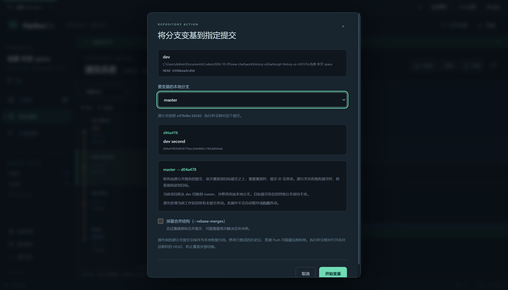
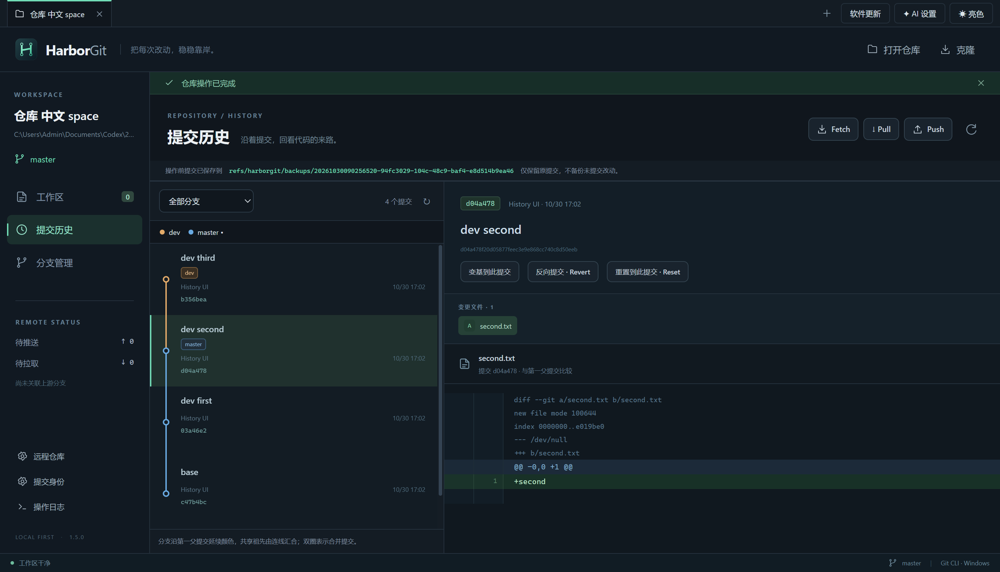

# 指定源分支变基到某个提交（v1.5.0）

在“提交历史”选择一个提交，点击 **变基到此提交**，再选择 **要变基的分支**。例如当前打开 dev，也可以选择 master 作为被修改的本地分支，无需先手动切换。

## 对应你的例子

设提交顺序如下，master 尚在共同起点 A，dev 有 C1、C2 两个新增提交：

```text
A ─ C1 ─ C2
↑         ↑
master    dev
```

选择 C2，再将源分支选为 master 并执行：

```text
A ─ C1 ─ C2
          ↑
       master, dev
```

master 没有需要重新应用的独有提交，Git 会让它前进到 C2，通常不产生重写的新提交。dev 引用保持不变。如果 dev 还有 C3，而选择 C2，master 只到 C2，不会跟到 dev 最新 tip C3。

若 master 本来有自己的提交 M，变基后是把 M 重放成 M′：

```text
操作前： A ─ C1 ─ C2 ─ C3   dev
          └ M              master

操作后： A ─ C1 ─ C2 ─ C3   dev（不变）
                    └ M′   master
```

目标 C2 的祖先 C1 会包含在 master 的结果中。只要 C2 的补丁、不要 C1，是另一种 cherry-pick 需求；本入口不会悄悄改变为该语义。此功能也不等于带 old-base 边界的高级 `--onto` 范围移植。

## 操作步骤

1. 打开仓库，进入“提交历史”，默认全部分支历史；如果提交未显示，调整历史范围或加载更多。
2. 选择目标提交，查看其消息、完整 hash 与文件 Diff。
3. 点击“变基到此提交”。
4. 在“要变基的分支”中选择 master。只提供本地源分支，远程分支不能直接被改写。
5. 检查方向、源分支快照与目标 hash。选择非当前源分支时，对话框明确说明将从 dev 切到 master，并修改 master。
6. 点击“开始变基”。冲突时沿用“继续变基 / 跳过当前提交 / 中止变基”。

原有“分支管理 → 将当前分支变基到目标分支”入口也提供源分支选择，仍支持原来的当前分支默认行为及保留合并结构。

执行成功后，当前工作区停在所选源分支 master。发生冲突后中止，会恢复 master 的原 tip，并停留在 master；不会自动切回最初查看历史时的 dev。dev 自身引用始终不因这个操作移动。

## 状态和保护

- 当前工作区须在正常已提交的本地分支上，并先处理暂存、未暂存及普通未跟踪改动。不自动 stash/shelf。无关 ignored 构建目录继续允许保留。
- 对话框固定当前工作区 HEAD 和所选源分支的原 hash。外部工具改变其中任何一个，执行前拒绝并要求重新确认。
- 源分支在另一个 worktree 检出时拒绝，不从当前窗口改写别的工作区。
- 目标 hash 解析成固定 commit OID；分支目标和提交目标严格二选一。不能把任意 shell 参数、revision 表达式或远程分支当作源分支传入。
- 安全路径范围包含当前工作区、源分支 tip、目标提交及源分支重放范围，沿用 ignored 覆盖碰撞、符号链接/子模块/联接目录检查。
- 恢复引用备份的是 **master 的原 tip**，不是误用当前 dev 的 HEAD；恢复引用只保存已提交内容，不能找回被丢弃的未提交编辑。

## IDEA 依据与自行设计

[本机 IDEA 增量证据](IDEA-REBASE-TARGET-ANALYSIS.md)确认：

- Log 的 `GitRebaseOntoCommitAction` 取得所选提交 hash，调用当前分支的 rebase 路径。
- 普通 Rebase 对话框另有 SWITCH_BRANCH、本地源分支选择以及 source branch 参数。
- 普通参数顺序可概括为 `git rebase <upstream/hash> [sourceBranch]`；高级 `--onto newBase` 是独立参数。

HarborGit 将这些能力组合成统一的“源分支 → 目标提交”确认窗口，这是自行编写的交互设计，不声称 IDEA 有完全相同的单个对话框。研究使用 REA 已验证的 JAR occurrence 证据与 javap 补充 JVM 语义，未在 IDEA 中执行用户仓库变基。源文件、哈希、字节码 offset、REA Evidence ID 及未确认边界均在报告中。

## 验证和交付

所有 Git 写验证使用新建的 `work/` 专用仓库：

- [6 项专项后端结果](verification-v1.5-target-rebase.txt)：从 dev 指定 master 到中间提交；master 独有提交重放；冲突中止/重启/继续；过期源引用；其他 worktree 占用；输入与未提交内容保护；原分支目标兼容。
- [2 项专项界面结果](verification-v1.5-target-ui.txt)：真实 Electron 选择 dev 第二个提交、把源分支改成 master、确认结果与源 tip 备份；外部改动源引用后保留错误窗口并拒绝切换。
- [完整后端回归](verification-v1.5-backend-final.txt)：57/57 通过，含原有分支变基、冲突恢复、回滚、Git/AI/更新功能。
- [安装后界面](verification-v1.5.0-installed-ui.txt)与[安装/卸载记录](verification-v1.5.0-installer.json)：7/7 通过。独立 QA 身份使用与正式版相同的 EXE/ASAR，验证提交闭环、更新入口、原历史操作及新增提交变基；卸载后应用、注册项与快捷方式已清理。测试不会对正式应用执行覆盖升级。
- [更新元数据](verification-v1.5.0-update-metadata.json)：实际 Setup 的 SHA-512 和大小与 latest.yml 相符；[图标核验](verification-v1.5.0-icons.json)记录自有图标的 PE 资源。源码与产物哈希见 [交付清单](delivery-manifest-v1.5.0.json)。

启动与打包命令不变：`npm start`、`npm run dist:setup`、`npm run verify:updates`。本次没有推送源码/tag，也未创建 GitHub Release；Windows 安装版可直接使用，macOS 配置保留但新增操作未做真机验证。

暂未提供：高级 `--onto` 范围选择、交互式变基、自动 stash/shelf、仅复制某次提交补丁的 cherry-pick 新入口。其余 v1.4 功能边界仍见 [历史操作说明](HISTORY-ACTIONS.md)。




