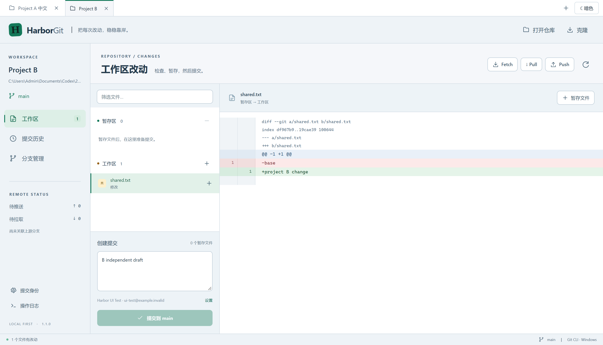

# HarborGit 1.1.0 更新说明

本次在现有 Electron + React + TypeScript 客户端上实现三个功能；IDEA 原始调查证据保持不变。

## 多项目标签

继续点击“打开仓库”或“克隆”会打开新标签；右上角 `+` 可打开空项目标签。点击标签切换项目，`×` 关闭标签。重复打开同一仓库会定位已有标签。切换期间，各项目的提交消息、文件选择、Diff、导航和日志独立保留，Git 请求和进度显式绑定会话；每个仓库使用自己的队列。后台项目的操作不会因切换标签转移到另一个仓库。

关闭标签不改变仓库文件；运行中的任务要先完成或取消。项目标签列表和提交草稿保留在本次应用会话中，最近仓库路径仍会保存。

## 明暗主题

顶部右侧的“亮色 / 暗色”按钮切换全局主题。亮色主题覆盖工作区、Diff 增删色、提交表单、历史、分支、日志、对话框及冲突编辑器。主题选择会记住；两个主题均为 CSS 调色，没有使用画面反色。

## dev 已提交内容合并到 master

1. 保持项目在 `dev` 分支，允许存在已暂存、未暂存及未跟踪文件。
2. 打开“分支管理”，点击 **“将当前分支合并到…”**。
3. 目标选择 `master`，点击 **“合并已提交内容”**。
4. 自动合并成功后，`master` 更新，原项目仍在 `dev`，原文件内容和暂存状态保留。无需先提交这批未完成代码。
5. 如果已提交的内容之间存在冲突，自动打开 **“合并 → master”** 标签。解决冲突并暂存、提交后，点击“结束并关闭合并标签”。也可以中止合并后结束该标签。原 `dev` 的工作区和提交草稿独立保留。

实现先固定源分支 HEAD，在目标分支的独立 Git worktree 中执行合并，合并输入只包括已提交对象。没有把 dev 的未提交内容复制进去，也没有对原项目执行 stash、切分支或强制重置。Git worktree 为同一仓库提供独立 working tree / index，参见 [官方 worktree 文档](https://git-scm.com/docs/git-worktree)。

原来的“合并到当前”也移除了“工作区不干净就直接拒绝”的应用检查，交给 Git 检查兼容性；不重叠的本地修改可以保留后合并。重叠编辑仍受 Git 保护，推荐使用上述源分支 → 目标分支流程。参见 [Git merge 文档](https://git-scm.com/docs/git-merge)。

目标分支已在另一个 worktree 中检出时，会明确告知位置并停止，不覆盖该工作区。提交之间的真实冲突仍需处理，不会自动选择一侧丢弃内容。合并工作区的元信息和恢复路径会保存；遇到冲突可以保留标签或从“最近仓库”重新打开其路径。结束工作区仅使用非强制 `git worktree remove`，存在未提交内容时拒绝清理。

## 验证

所有写验证继续只使用新建的专用测试仓库，远程仅连接本地裸仓库。

- [后端测试](verification-v1.1-backend.txt)：**16/16 通过**。新增多项目并发隔离、重复打开和关闭、脏 dev → master 的精确内容与 index 比对、冲突解决后提交、重开后中止与清理、其他 worktree 的保护、普通合并的 Git 兼容性检查。
- [源版本界面首轮](verification-v1.1-ui.txt)：原三组流程、智能合并成功流程、独立冲突标签流程通过；多项目测试的定位器同时匹配隐藏标签输入框，导致测试失败。改为定位可见的 textbox 后，[多项目复查](verification-v1.1-ui-tabs-recheck.txt)通过，验证提交草稿/暂存隔离、重复定位、关闭标签，以及明暗主题和重启后记忆。
- [发行包界面验证](verification-v1.1-packaged-ui.txt)：在真实 `release/win-unpacked/HarborGit.exe` 对全部六组流程复测，**6/6 通过（约 2 分钟，无 renderer page error）**。
- [构建日志](verification-v1.1-build.txt)：类型检查、生产构建及 Windows x64 便携打包完成。[单文件启动检查](verification-v1.1-portable.json)：**通过**，实际启动 1.1.0 自解压 EXE，核验主窗口、版本及隔离桥接，正常退出并清理专用配置目录。

单文件便携版 SHA-256：`196b788196a0116205764aadb7315c8da1436271ae1c83f102fb7ed0da77ba9e`。最终源码及应用 ASAR 身份见 [交付清单](delivery-manifest-v1.1.json)。

新功能源码主要在 `src/main/workspaces.ts`、`src/main/git-service.ts`、`src/renderer/App.tsx`、`src/renderer/themes.css`；对应集成测试位于 `tests/git.test.ts` 与 `tests/electron.spec.ts`。原有启动、开发和打包命令不变，详见 [README](../README.md)。
