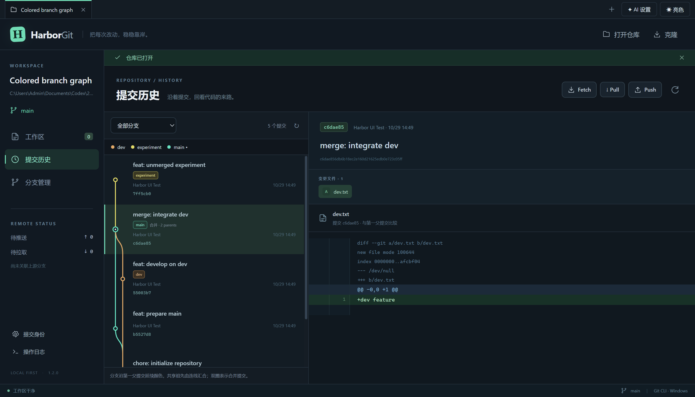
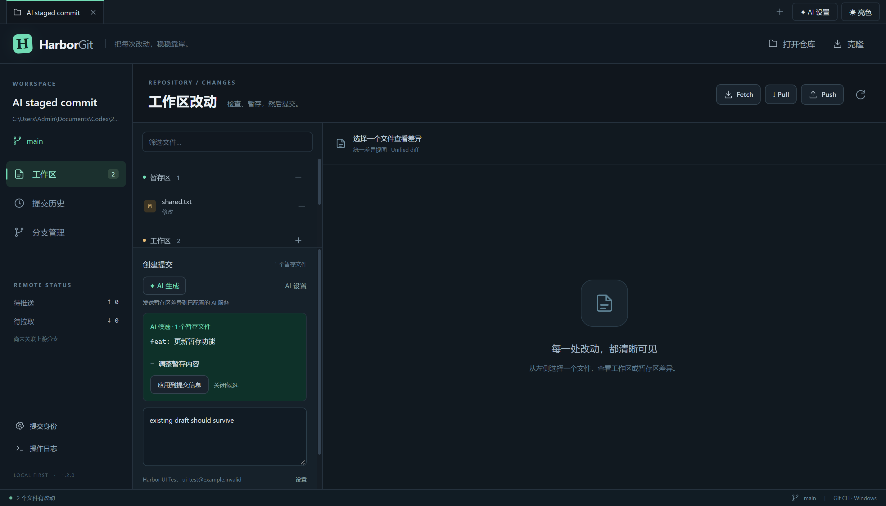

# HarborGit 1.2.0 更新说明

本次新增彩色提交图与 AI 提交消息，保留 1.1 的多项目标签、明暗主题及保留未提交内容的智能合并。所有功能为 HarborGit 自行实现，原 IDEA 调查报告保持独立。

## 分支颜色和合并路径

打开“提交历史”，默认查看全部本地分支、远程分支、标签与当前 HEAD 可达的提交，也可以筛选为当前分支。历史按拓扑顺序排列：子提交位于父提交上方。

- 命名分支使用分隔色板，常见主干有固定颜色；分支图例和引用徽标与路径色对应，明暗主题均可读。
- 连线来自 Git 实际返回的 parents：第一父路径延续轨道，分叉和多父合并显示连接。双圈表示合并提交，旁边显示父提交数。
- 加载更多时保留已有轨道，边界提示路径继续向下，支持多个根和多父合并。
- 选中提交仍能查看文件清单和 Diff；合并提交的文件差异与第一父提交比较。

Git 提交本身不记录唯一的“所属分支”。多个分支共享祖先时，图中显示其合流路径，不把颜色当作历史创建分支的确定事实。切换当前分支或引用指向发生变化时，共享节点的主路径显示可以变化。

## AI 生成提交消息

1. 顶部点击 **AI 设置**。
2. 选择 **OpenAI Responses** 或 **Chat Completions（兼容接口）**。
3. 填写服务的**基础地址**、**模型 ID**、**API Key**，以及语言与消息格式。基础地址通常包含 `/v1`；应用会追加对应的 `/responses` 或 `/chat/completions`。无鉴权的本地兼容服务可不填 Key。
4. 暂存需要提交的文件，点击提交栏的 **AI 生成**。
5. 检查候选消息，点击 **应用到提交信息**；可继续编辑，最后由你点击提交。

不会默认选择或自动替换模型。生成时发送暂存文件清单和相应的暂存 Diff 到你配置的服务；未暂存修改和未跟踪文件不作为输入。生成按钮与设置中均说明了这一行为。

快照固定在一个 index tree：后续工作区修改不会混入输入。生成后以及应用候选前检查暂存区是否变化，过期候选会要求重新生成。已有提交草稿在预览期间保留，生成失败或取消不会替换草稿，也不会自动提交。

消息可用中文或英文，格式可选 Conventional Commits 或简洁描述。二进制文件仅提供名称/状态和差异提示；大 Diff 限 80,000 字节并标明截断，文件清单限 1,000 项，总 JSON 输入限 250,000 字节。候选需要人工检查，应用没有把模型输出当作已验证的事实。

API Key 只在主进程使用，通过 Electron 系统加密保存，不回传给 renderer。更换服务地址会清除旧凭据，避免把原 Key 带到新服务。系统加密不可用时 Key 只保留在本次会话内存中。支持取消、两分钟超时、HTTP 错误反馈、响应长度限制和日志脱敏。

## 验证与边界

所有 Git 写入只在专用测试仓库；远程仅使用本地裸仓库。AI 网络测试只连接本地 HTTP fixture，使用固定测试返回文本和无效的示例 Key。截图是实际应用通过该测试接口生成的候选预览，不代表真实模型质量测试。

- [完整后端回归](verification-v1.2-backend-final.txt)：**23/23 通过**，包含原有 Git 功能、全部分支/拓扑/分页/unborn HEAD、多父合并、固定暂存快照、真实重命名/二进制、两种 API 协议、错误/超时/取消、凭据隔离和暂存区变化检测。
- [最终图与 AI 专项](verification-v1.2-graph-ai-final.txt)：**7/7 通过**，进一步验证分支色分配不重复且不依赖引用列表顺序。
- [AI 界面复查](verification-v1.2-ai-ui-recheck.txt)：配置、生成、预览、应用、实际提交、陈旧快照拒绝、HTTP 401 脱敏、取消、重启后加密 Key 恢复通过。首轮完整界面测试因取消提示的测试预期文案不同失败，已修正测试；[首轮输出](verification-v1.2-ui.txt)保留。
- [发行包完整界面测试](verification-v1.2-packaged-ui.txt)：在真实 `release/win-unpacked/HarborGit.exe` 验证八组功能，**8/8 通过（约 2.5 分钟，renderer page errors 为零）**。
- [构建日志](verification-v1.2-build.txt)：类型检查、生产构建与 Windows x64 便携打包完成。[单文件启动检查](verification-v1.2-portable.json)：实际启动自解压 EXE，版本/主窗口/隔离桥接核验通过，正常退出并清理专用配置目录。[交付清单](delivery-manifest-v1.2.json)记录源码及 ASAR 身份。

最终便携版 SHA-256：`812520fd9ae1c07a6e248aee4a5e97b4870fb9040228ee0e42cde564b51c2503`。

本次没有用户的真实 AI 服务凭据，未调用付费/真实模型，因此不宣称已验证所配置供应商的认证、模型可用性或生成质量。需要你在设置中填写自己的服务信息后使用；第三方接口须兼容所选协议。应用没有打包离线模型。

实现依据采用官方 OpenAI Docs 的 [文本生成](https://developers.openai.com/api/docs/guides/text) 和 [Chat Completions API](https://developers.openai.com/api/reference/resources/chat/subresources/completions/methods/create)。具体图布局、暂存快照、设置和交互属于独立产品设计。

## 项目位置与命令

源码新增 `src/shared/commit-graph.ts`、`src/renderer/CommitHistory.tsx`、`src/renderer/AiSettingsDialog.tsx`、`src/main/ai.ts`。回归测试新增 `tests/graph-ai.test.ts` 并扩展真实 Electron 测试。

启动与打包命令不变：`npm ci`、`npm start`、`npm run dev`、`npm test`、`npm run test:ui`、`npm run pack`、`npm run dist`。详见 [README](../README.md)。
