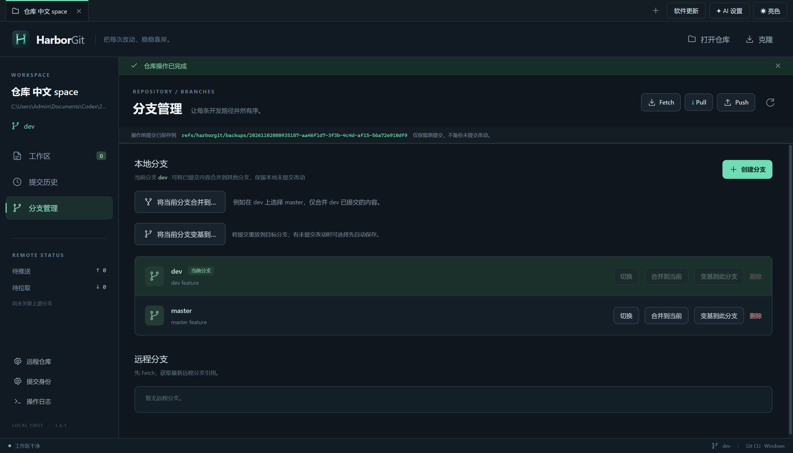

# HarborGit v1.6.1 — 修复开始变基时的未跟踪内容误拦截

日期：2026-11-02（Asia/Shanghai）。本版是 1.6.x 的问题修复，保留已有功能和备份格式。

## 原因与复现证据

用户反馈在点击“开始变基”时出现“请先移走或妥善保存未跟踪内容，再继续操作；不会删除这些内容”。已确认该提示由 HarborGit 的前置检查产生，还没有执行本次底层 Git rebase。

`GitService.untrackedPaths` 使用 `git ls-files --others --directory --exclude-standard -z`，会列出未跟踪空目录；界面的状态来自 `git status --porcelain=v2 -z --untracked-files=all`，不列空目录。1.6.0 的 `safeTreeWrites` 在 sequencer 策略发现任何普通未跟踪内容时即拒绝，未区分其路径是否会被操作覆盖。因此可能出现“界面显示干净、没有自动保存选项，却无法开始变基”。

专用仓库中创建 `输出 临时/空目录`，其状态列表为空，但点击开始前的安全检查抛出同样消息；[修复前记录](verification-v1.6.1-before-fix.txt)保留了这一复现。该日志中预期有 3 项回归断言失败，用来证明旧版缺陷，另有 1 项原有保护测试通过。报错仓库的实际目录尚未读取，本报告确认的是客户端条件和可重复复现，不据此断言用户仓库中一定是哪一个目录。

## 修复

- 对变基单独使用路径检查策略：允许不相交的未跟踪文件和目录，仍保护与当前树、源分支、目标基底和中间提交可能写入路径相交的内容。
- 应用于开始变基、自动保存后的检查、继续、跳过、中止，以及原 WIP 恢复的路径检查。恢复原 WIP 前对实际文件改动的干净状态要求仍保留，防止重复应用。
- 新的变基路径检查遇到覆盖风险时，展示最多 8 条具体路径及剩余数量。自动保存前的既有保护检查仍生效。
- 保留 ignored 内容、路径大小写和目录层级检查，保留 HEAD / 源分支快照与其他 worktree 占用检查；未放宽 Revert、Hard Reset 和特殊文件模式的既有规则。

实现：[GitService](../src/main/git-service.ts) 的 `untrackedPaths`、`safeTreeWrites`、`startRebase`、`rebaseAction` 和 `restoreRebaseSaved`。回归：[历史操作测试](../tests/history-actions.test.ts)、[WIP 测试](../tests/rebase-save.test.ts)和[真实界面测试](../tests/history-ui.spec.ts)。

## 已完成验证

| 验证 | 结果 |
| --- | --- |
| 专项回归 | **5/5**，[日志](verification-v1.6.1-targeted.txt)：干净仓库有空目录仍能开始，Continue / Skip / Abort 保留无关文件，实际中间路径冲突仍受保护，WIP 在新空目录存在时仍可恢复 |
| 完整回归 | **71/71**，[日志](verification-v1.6.1-tests.txt)：包含既有 Git、AI、多项目、远程和更新测试 |
| 开始变基的真实 Electron 界面 | **1/1**，[日志](verification-v1.6.1-target-ui.txt)：不显示自动保存选项的干净仓库直接开始并完成变基，原空目录保留 |
| 最终安装载荷的界面回归 | **10/10**，[日志](verification-v1.6.1-installed-ui.txt)，包含本次复现及已有历史、WIP 恢复、提交和更新入口 |
| 隔离安装与卸载 | **通过**，[记录](verification-v1.6.1-installer.json)：使用独立 QA 标识与中文空格目录，EXE / ASAR 与交付载荷相同；卸载移除测试安装、注册项与快捷方式 |
| 类型检查与 Setup 打包 | **通过**，[构建记录](verification-v1.6.1-package.txt) |
| 更新附件和自定义图标 | **通过**，[更新元数据](verification-v1.6.1-update-metadata.json)、[图标资源](verification-v1.6.1-icons.json) |

所有 Git 写入验证使用专用测试仓库，远程操作通过本地裸仓库验证。本次是自有客户端源码修复；既有 [IDEA 分析与实现差异](IDEA-REBASE-WIP-ANALYSIS.md)继续保留，没有把本次策略调整归为新发现的 IDEA 行为。

安装验证前后，现有 HarborGit 主进程均为 PID 49912、路径 `D:\Harbor\HarborGit\HarborGit.exe`，未被测试安装替换。Setup SHA-256：`4642695c4b06d542782f987823717dd3102d5ab8ce33129996315f2d7be902aa`。最终源码和产物哈希见 [交付清单](delivery-manifest-v1.6.1.json)。

## 使用

安装 `HarborGit-1.6.1-Setup-x64.exe` 后重试。若只是无关空目录，不需要为了变基先提交或删除它；有实际未提交文件改动时，仍需明确勾选“自动保存未提交改动后变基”。如显示具体覆盖路径，请先保存或移走对应内容。

源码运行：`npm ci` 后 `npm start`。打包：`npm run dist:setup`。发布附件应同时包含 Setup、对应 `.exe.blockmap` 与 `latest.yml`；[Release 描述](../release-notes.md)已更新。本次仅生成本地交付，没有推送源码、tag 或发布 GitHub Release。

当前交付的已提交历史备份与 WIP 恢复范围沿用 [1.6.0 说明](REBASE-SAVED-CHANGES.md)。Shelf、高级 `--onto`、交互式变基和自动处理实际覆盖冲突不在本补丁范围内。
