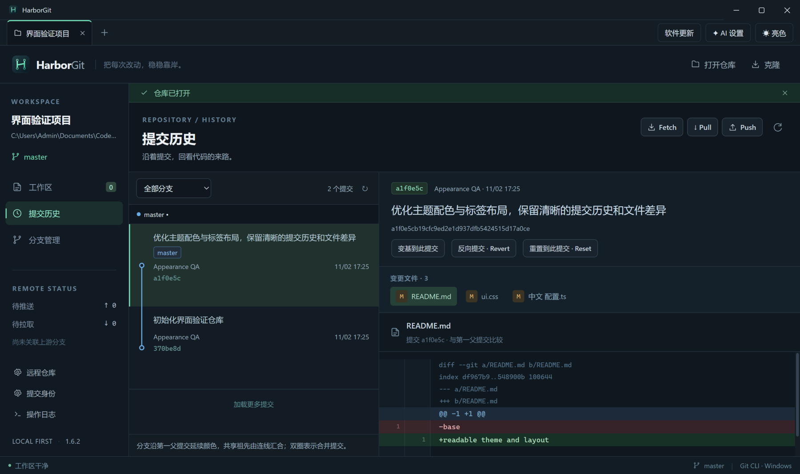
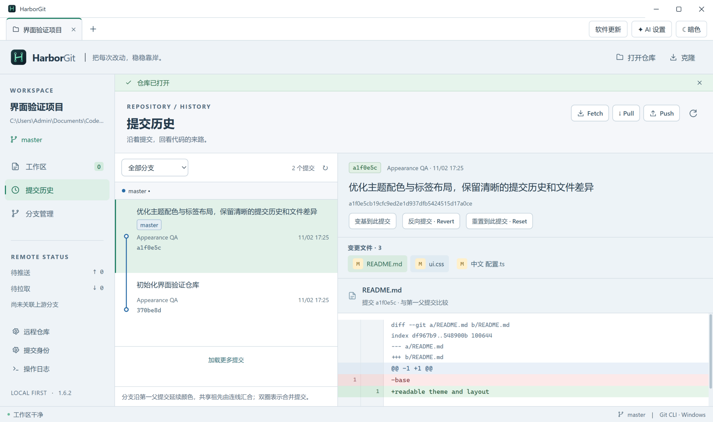
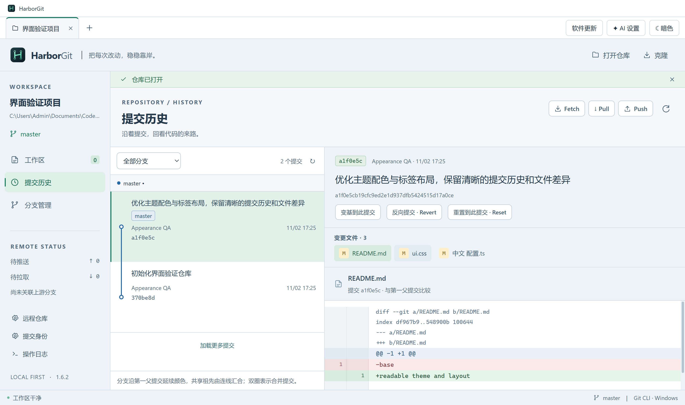
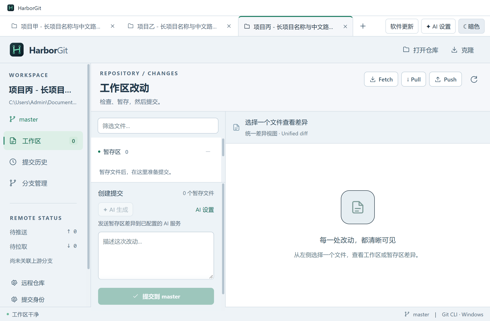

# HarborGit v1.6.2 — 字号、主题标题栏与标签布局

日期：2026-11-02（Asia/Shanghai）。本版为 1.6.x 的界面修复和体验优化。

## 调整结果

| 区域 | 变化 |
| --- | --- |
| 辅助文字 | 原先大量 8–11px 的标签、作者、日期、哈希和说明提高到以 12px 为主 |
| 正文与操作 | 正文 14px，常用按钮和文件名使用 13–14px；重新安排侧栏、标题、间距和文件列表宽度 |
| Diff | 代码使用 13px，元数据和行号使用 12px，保留代码的横向滚动 |
| 提交历史 | 调整行高以容纳标题、分支标签、作者和哈希；连线与节点继续对应同一行 |
| Windows 标题栏 | 标题区域及系统绘制的最小化、最大化、关闭按钮随亮暗主题配色；保留窗口拖动区域 |
| 亮色文件悬停 | 普通悬停改为浅蓝灰，选中项悬停使用浅绿，不再出现深色块 |
| 新建标签 | “＋”紧跟最后一个项目标签；溢出时保持可见，切换或打开新项目后滚动整个标签，包含关闭按钮 |
| 窄窗口 | 验证 1100×720 的长中文标签及溢出布局；侧栏和提交区保留滚动，日志入口可达，提交按钮使用底部粘附定位 |

调整前实测历史作者字号为 **9px**，单个标签右端与“＋”之间相隔约 **1023 CSS px**；调整后作者为 **12px**、Diff 代码为 **13px**，“＋”与末尾标签相隔 **6 CSS px**。见 [调整前计算样式](verification-v1.6.2-before.json)与[调整后计算样式](verification-v1.6.2-appearance-metrics.json)。前图是选中状态，仅用于字号与按钮位置对照；普通悬停配色另由未选中文件的界面断言核验。

## 主题与实现位置

Windows 使用 Electron 的 [Window Controls Overlay](https://www.electronjs.org/docs/latest/api/base-window#winsettitlebaroverlayoptions-windows-linux) 设置系统按钮区的背景和符号颜色，同时通过 [nativeTheme](https://www.electronjs.org/docs/latest/api/native-theme) 同步应用的原生主题。没有修改 Windows 全局个性化设置。实现见 [appearance.ts](../src/main/appearance.ts)、[主进程](../src/main/main.ts)、[preload](../src/main/preload.ts)和[主题与标签状态](../src/renderer/App.tsx)。

主题偏好保存在应用 `userData` 目录下的 `appearance.json`，默认目录为 `%APPDATA%\HarborGit`。文件只保存 `theme` 字段；首次升级兼容旧版 `localStorage` 的 `harbor-theme`。已有主进程偏好优先，避免重启后应用与标题栏使用不同主题。IPC 校验发送窗口和主题值；无效值不会改变当前主题。快速主题设置的文件写入按顺序执行。

字号令牌在 [styles.css](../src/renderer/styles.css) 定义，相关样式引用令牌；布局修正在 [readability.css](../src/renderer/readability.css)。提交图行高由 [commit-graph.ts](../src/shared/commit-graph.ts) 的公共常量同时驱动列表和 SVG。更新提示、日志抽屉及模态遮罩的位置随新标题栏高度调整，避免遮挡顶部按钮。

## 验证

- **相关后端 16/16**：[图形 / AI 与更新回归](verification-v1.6.2-backend.txt)。Git 服务实现未修改。
- **源码界面 5/5**：[最终回归](verification-v1.6.2-source-ui.txt)。覆盖原生主题、亮色悬停、字号、原生最大化与还原、关闭重启、旧偏好迁移、长标签溢出、打开后标签宽度变化、多项目草稿、彩色提交图和更新弹窗。
- **小窗口最终修正 1/1**：[专项回归](verification-v1.6.2-compact-final.txt)。提交按钮使用不透明底部容器，避免遮挡时透出身份文字；截图等待仓库刷新结束后再采集。
- **安装后界面 14/14**：[实际安装载荷回归](verification-v1.6.2-installed-ui.txt)，额外覆盖原有提交闭环、分支、Revert / Reset、文件回滚、指定提交变基与 WIP 恢复。
- **隔离安装与卸载通过**：[记录](verification-v1.6.2-installer.json)。使用独立 QA 标识及中文空格安装目录，安装后的 EXE / ASAR 与正式载荷逐字节一致；卸载已移除测试安装、注册项和快捷方式。现有 HarborGit 主进程 PID 36248、路径 `D:\Harbor\HarborGit\HarborGit.exe` 在验证前后相同。
- **类型检查与生产构建通过**：[构建记录](verification-v1.6.2-build.txt)。
- **Setup 更新元数据和图标通过**：[附件校验](verification-v1.6.2-update-metadata.json)、[9 个尺寸的图标核验](verification-v1.6.2-icons.json)。

测试使用专用仓库和独立应用配置。原生窗口截图通过测试窗口自身的媒体 ID 捕获，包含系统窗口按钮；页面截图与原生缩略图的尺寸不同，字号变化以计算样式为准。验证平台为本机 Windows，未据截图宣称完整无障碍合规，也未穷尽所有系统快捷键与显示缩放组合。

## 运行与交付

源码：`npm ci` 后 `npm start`。开发：`npm run dev`。打包：`npm run dist:setup`。本次生产打包在构建完成后直接调用同一 electron-builder NSIS 配置，未重复修改正在进行界面验证的构建目录。

Setup 为 `release/HarborGit-1.6.2-Setup-x64.exe`。发布更新需同时包含 Setup、对应 `.exe.blockmap` 与 `latest.yml`；[Release 描述](../release-notes.md)已更新。本次仅生成本地交付，没有推送源码、tag 或发布 GitHub Release。

Setup SHA-256：`c9ade151c86d99d811515bfbba0bee3c2e0eca512c614d21ddae79eff45d947b`。最终源码和产物哈希见 [交付清单](delivery-manifest-v1.6.2.json)。
