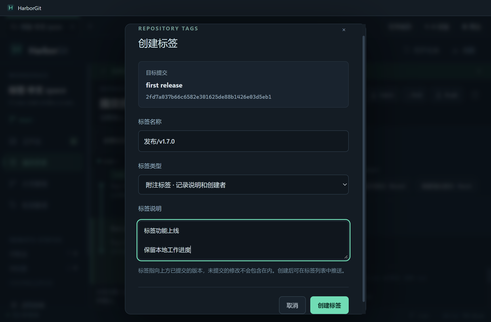
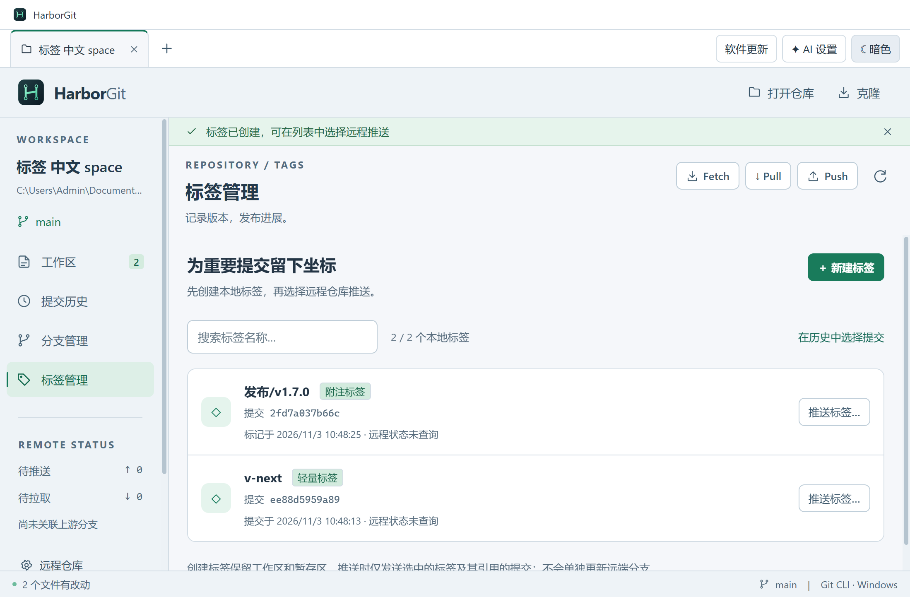
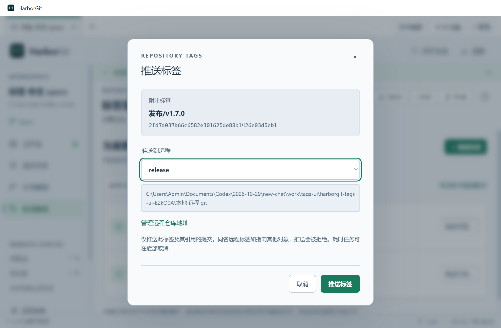

# HarborGit 1.7.0 — 创建与推送 Git 标签

日期：2026-11-03（Asia/Shanghai）。新增标签管理能力，采用兼容既有功能的次版本号 1.7.0。

## 使用方式

**提交历史 → 选中提交 → 创建标签 → 标签管理 → 推送标签 → 选择远程并确认。**

也可以从“标签管理 → 新建标签”为当前 HEAD 创建标签。附注标签记录说明和创建者，轻量标签只标记提交；两个入口均保留现有暂存、未暂存及未跟踪内容。详见 [完整操作指南](TAGS.md)。







## 操作流程与实现证据

| 入口 → 状态变化 | 内部调用与 Git 操作 | 结果展示 |
| --- | --- | --- |
| 标签管理新建 / 历史提交创建 → 固定目标提交快照 | `createTag`：校验 `refs/tags/<name>`、解析提交对象、拒绝重复名称；附注使用 `git tag --no-sign -a --file=-`，轻量使用 `git tag --no-sign`；名称与哈希作为独立参数 | 成功后回到标签列表；刷新历史引用；失败保留表单与错误详情 |
| 标签列表推送 → 固定标签对象 ID、选择远程 | `pushTag`：确认本地标签仍指向同一对象、远程存在且只有一个推送地址；执行 `git push <remote> <object-ID>:refs/tags/<name>` | 进度进入现有操作日志，底部可取消；成功显示标签和远程名称，失败保留对话框与命令输出 |
| 外部工具移动 / 删除标签 → 确认快照过期 | 推送前比较完整对象 ID；通过后仍用对象 ID 作为源，避免检查后标签变化影响发送内容 | 提示关闭并刷新后重试；未执行推送 |

类型与 IPC 契约见 [types.ts](../src/shared/types.ts)，调用入口见 [App.tsx](../src/renderer/App.tsx)，独立界面见 [TagsPanel.tsx](../src/renderer/TagsPanel.tsx) 和 [tags.css](../src/renderer/tags.css)，Git 实现见 [GitService](../src/main/git-service.ts)。所有 Git 调用沿用参数数组、`shell: false`、仓库会话队列、进度日志、超时和进程树取消机制。

标签推送明确关闭 `push.followTags`、远程镜像和递归子模块推送，指定唯一目标引用；不会强制覆盖远程已有标签。不改写仓库配置。普通分支 Push 的既有配置行为保留，单标签推送请使用此专用入口。

## 分析所得与自行设计

[本机 IDEA 证据](IDEA-TAGS-ANALYSIS.md)确认了 Git 菜单创建标签、提交历史指定提交创建标签、按远程推送单标签，以及普通 Push 的 `--tags` / `--follow-tags` 路径。静态证据、推断与未确认内容分别列在调查文档中；未把静态分析称为 IDEA 的真实远程执行验证。

REA 未直接支持 JVM class，按已记录的格式限制使用 Python 读取 JAR、JDK `javap` 分析字节码。完整来源和哈希保留于 [证据目录](evidence/tags-2026-11-03/source-identities.json)。

HarborGit 的独立标签页面、类型选择、目标快照、单对象推送及状态展示均为自行编写，没有移植 IDEA 代码。此前 1.6.2 仅显示标签的 [历史能力核对](HARBORGIT-TAG-CAPABILITIES.md)与运行记录保留，不改写为新版结果。

## 验证记录

- [后端全套回归](verification-v1.7.0-backend.txt)：**80/80**，包含新增标签专项 **9/9**；覆盖中文空格路径、历史目标、两种标签、签名配置、重复和无效输入、脏工作区保留、指定远程、精确推送、镜像与自动跟随配置、远端拒绝、过期确认、超时及主动取消。
- **源码标签界面 3/3**：[标签界面验证](verification-v1.7.0-tags-ui.txt)：创建与推送闭环、搜索、空仓库和无远程引导、冲突提示、明暗主题与最小窗口。
- **安装后回归 17/17**：[完整日志](verification-v1.7.0-installed-ui.txt)，涵盖标签、提交闭环、多项目、主题、历史操作和更新入口。
- **隔离安装与卸载通过**：[安装记录](verification-v1.7.0-installer.json)。安装 EXE / ASAR 与交付载荷完全一致；测试安装、注册项和快捷方式已移除，原应用进程前后一致。
- **更新元数据与自定义图标通过**：[更新附件](verification-v1.7.0-update-metadata.json)、[图标校验](verification-v1.7.0-icons.json)。
- [生产构建与 Setup 打包](verification-v1.7.0-build.txt)。

全部写入验证使用专用仓库、本地裸仓库及独立应用配置。没有向真实 GitHub 仓库推送标签、提交代码或创建 Release。

## 启动与打包

```powershell
npm ci
npm start
npm run dev
npm run build
npm test
npm run test:ui -- tags-ui.spec.ts
npm run dist:setup
```

本次构建先执行生产编译，再用同一 electron-builder NSIS 配置生成 Setup。安装包为 `release/HarborGit-1.7.0-Setup-x64.exe`。GitHub 更新附件必须同时包含 Setup、对应 `.exe.blockmap` 与 `latest.yml`，发布描述见 [release-notes.md](../release-notes.md)。

## 尚未实现

标签删除或移动、强制推送、GPG / SSH 签名标签、批量推送、远程标签列表与同步状态查询；多个推送地址的远程暂不支持此界面。新建目标限定为提交，已有其他对象类型的标签可以显示。macOS 打包配置保留，本次只验证 Windows。

验证汇总见 [机器可读记录](verification-v1.7.0-tags.json)。Setup SHA-256：`c78491fa398c045d4369dd40e0161d556f031103ec5e0a100b56ffc0a15d9123`。最终源码与产物身份见 [交付清单](delivery-manifest-v1.7.0.json)。
