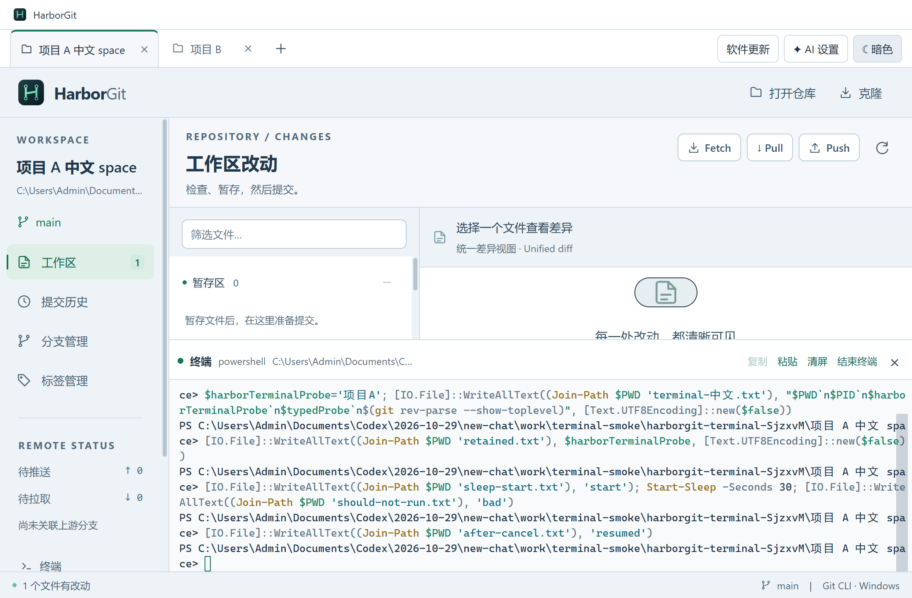

# HarborGit 1.8.0 — 项目内置终端

打开项目后点击左下角“终端”，或按 **Ctrl + 反引号键**。真实 PowerShell 会话从当前仓库目录启动；每个项目独立保留当前目录、变量和输出。支持中文、交互命令、Ctrl+C、复制粘贴、清屏、调整高度、明暗主题、结束及重新启动。

收起终端或切换项目保留会话，关闭项目或退出应用结束对应进程。终端中的改动不会触发 Git 界面的自动刷新，需要时点击刷新按钮。详细用法和实现边界见 [终端说明](TERMINAL.md)。



## 本次验证范围

按要求控制验证量，仅执行类型 / 生产构建和**一个终端专项运行场景**。没有运行完整后端套件、常规界面回归或安装卸载测试。

- [构建通过](verification-v1.8.0-build.txt)：TypeScript、前端分包、主进程及 preload 编译。
- [打包版终端检查通过](verification-v1.8.0-terminal.json)，[原始输出](verification-v1.8.0-terminal.txt)：真实按键、中文粘贴、仓库初始目录、Git 调用、项目会话隔离与保留、Ctrl+C、尺寸 / 主题切换，以及项目关闭和应用退出后的进程清理。全部写入使用专用测试仓库及独立用户配置，检查完成后已删除。
- [Setup 打包记录](verification-v1.8.0-package.txt)。专项运行的是本次 `win-unpacked` 中的真实 EXE，验证了原生终端依赖随包可加载；没有把它表述为已验证安装 / 卸载流程。
- [更新附件完整性](verification-v1.8.0-update-metadata.json)：Setup 文件大小、SHA-512、版本号及更新元数据一致。

未操作正在使用的 HarborGit 安装目录，没有上传 GitHub、推送标签或创建 Release。验证平台为本机 Windows，macOS 终端未验证。

## 运行与交付

```powershell
npm ci
npm start
npm run dev
npm run dist:setup
```

本版新增终端功能，采用次版本 1.8.0。源码和构建配置已更新，Windows Setup 为 `release/HarborGit-1.8.0-Setup-x64.exe`。发布时仍需配套 `.exe.blockmap` 和 `latest.yml`；描述见 [release-notes.md](../release-notes.md)。

当前每个项目仅一个终端；尚无 Shell 选择界面、同项目多终端标签或重启应用后的会话恢复。Windows 默认优先 PowerShell 7，缺省回退到 Windows PowerShell。

Setup SHA-256：`9ed7c44e540cca66d9f0272cba2ac08989f83716df9e7d75c4ac333f9141c04a`。最终源码与产物清单见 [交付清单](delivery-manifest-v1.8.0.json)。
