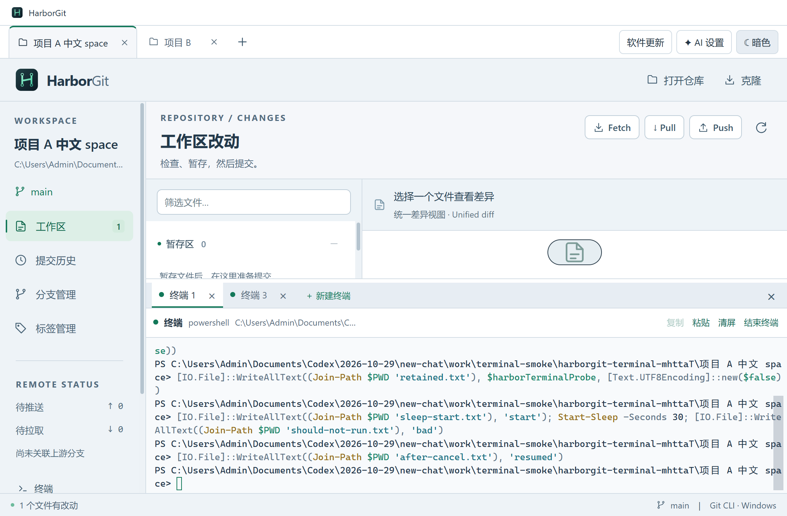

# HarborGit 1.8.1 — 多终端

在项目的终端面板上方点击 **＋ 新建终端**。同一项目可打开多个独立会话，通过“终端 1、终端 2…”标签切换。每个会话保留各自的目录、变量、输出和运行中的命令。

标签旁的 × 只关闭该终端。面板右侧的 × 收起整个面板、保留所有会话。关闭项目清理它下面的全部终端，保留其他项目的会话；退出应用清理剩余会话。

终端操作仍不自动刷新 Git 界面。用法见 [终端说明](TERMINAL.md)。本版继续完善 1.8.x 终端功能。



## 实现

[ProjectTerminal.tsx](../src/renderer/ProjectTerminal.tsx) 管理终端标签，每个标签保留独立的 xterm 实例。[terminal.ts](../src/main/terminal.ts) 根据项目和标签定位会话，按独立进程标识分发输入、输出、尺寸和解析确认。关闭尚在启动的标签也会取消后续创建，避免留下隐藏进程。

## 有限验证

按要求，只执行构建检查和一个打包版终端专项场景，没有运行完整回归或安装卸载测试。

- [构建通过](verification-v1.8.1-build.txt)：类型检查和生产编译。
- [终端专项通过](verification-v1.8.1-terminal.json)，[原始输出](verification-v1.8.1-terminal.txt)：同项目多终端的变量 / 目录隔离、后台运行、切换保留、独立关闭、项目关闭时清理全部会话，以及中文、Git 调用、Ctrl+C 和应用退出清理。
- [Setup 打包](verification-v1.8.1-package.txt)与[更新附件完整性](verification-v1.8.1-update-metadata.json)。专项运行的是打包目录中的实际 EXE，不代表已验证安装 / 卸载流程。

全部写入使用专用仓库与隔离配置，已移除测试目录。没有向真实远程推送、发布 Release 或覆盖正在使用的安装目录。

## 运行与交付

```powershell
npm ci
npm start
npm run dev
npm run dist:setup
```

Windows 安装包为 `release/HarborGit-1.8.1-Setup-x64.exe`。更新附件仍包括对应 `.exe.blockmap` 与 `latest.yml`。终端重命名、分屏和重启应用后的会话恢复尚未实现；本次验证平台为 Windows。

Setup SHA-256：`3df7156cc0aacabbec1a917733bd0f16980891324181d90f7454e9110a2188d0`。源码和产物清单见 [交付清单](delivery-manifest-v1.8.1.json)。
