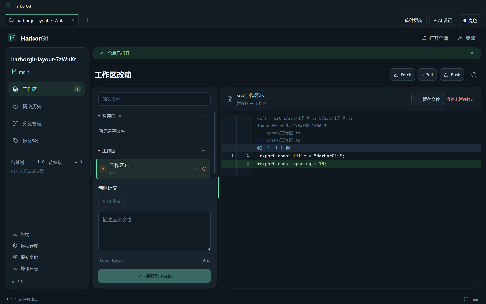
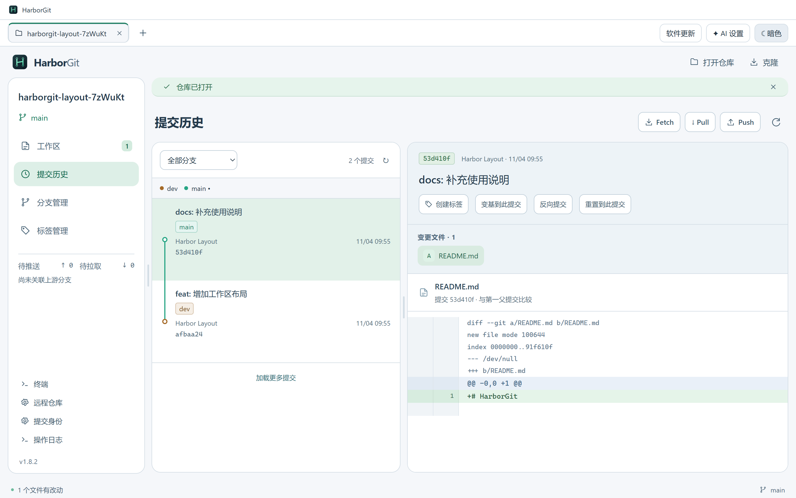
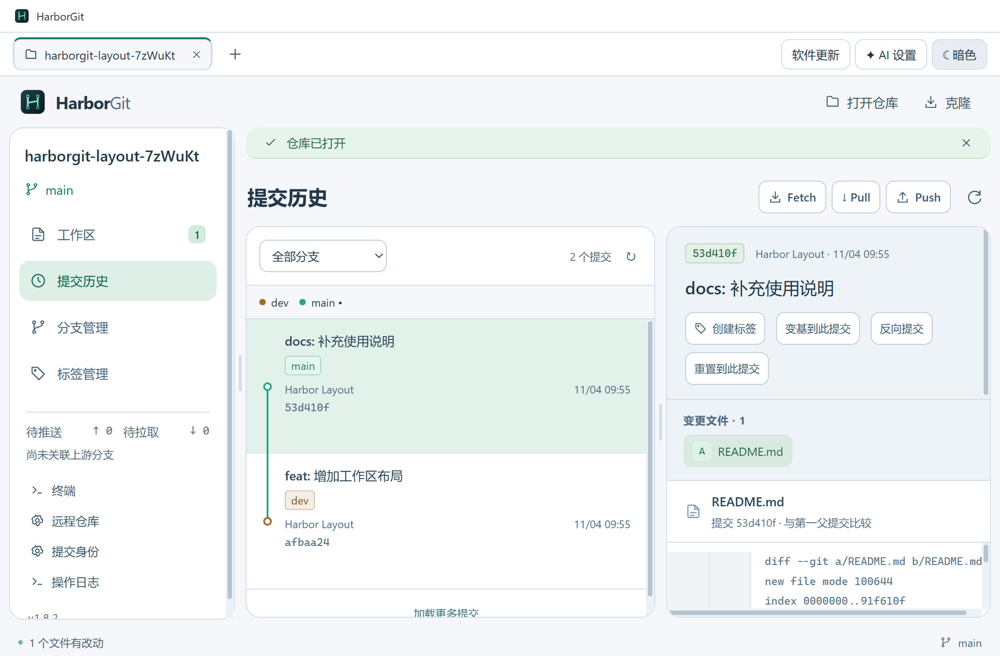

# HarborGit 1.8.2 — 圆角与可调布局

界面统一为圆角面板，导航、文件状态与 Diff 之间增加间距。精简重复英文标题、宣传说明、图例长提示和重复提交哈希；仓库路径与完整哈希仍可在对应标题悬浮查看。AI 生成按钮的悬浮提示说明将暂存区差异发送至已配置服务。错误、冲突、恢复与危险操作确认继续显示。

## 调整宽度

导航与主区、文件列表与 Diff、历史列表与提交明细之间均有可拖拽分隔线。鼠标悬停时高亮，双击恢复默认。聚焦分隔线后使用左右方向键调整，Shift 加速，Home / End 调整到当前可用边界。

三处分栏分别记忆偏好宽度，保存在当前应用配置对应的 localStorage 中；关闭并再次打开应用时读取。窗口缩小时仅限制实际显示宽度，保留原来的偏好，放大后可恢复。导航初始 212px，文件列表 320px，历史列表 400px。调整范围同时受窗口剩余空间约束，优先为 Diff 和提交明细保留至少 320px。

提交区独立滚动，按钮可换行。终端面板沿用高度拖拽和多会话能力，外框、标签和工具栏同步采用圆角与新的间距。







## 实现范围

- [ResizableDivider.tsx](../src/renderer/ResizableDivider.tsx)：偏好宽度、动态约束、指针捕获、键盘调节与本地记忆。
- [layout.css](../src/renderer/layout.css)：圆角、面板间距、简化排版与亮暗主题适配。
- [App.tsx](../src/renderer/App.tsx)、[CommitHistory.tsx](../src/renderer/CommitHistory.tsx)、[TagsPanel.tsx](../src/renderer/TagsPanel.tsx)：接入分隔线、精简重复文案。

本版为自行设计和编写的界面改动，没有新增 IDEA 逆向分析，也没有改变 Git 执行逻辑。

## 有限验证

按要求只执行生产构建与界面专项场景，没有运行完整 Git、终端、远程操作回归或安装卸载测试。检查使用专用仓库和隔离配置，不修改用户仓库或真实应用配置，不访问远程。

- [构建记录](verification-v1.8.2-build.txt)：TypeScript 和生产编译。
- [最终打包版界面专项结果](verification-v1.8.2-layout.json)：三处分栏拖拽、复位、键盘调整、宽度记忆、亮暗主题，以及 1100×720 窗口下的内容边界和入口可见性。
- [Setup 构建记录](verification-v1.8.2-package.txt)、[更新附件完整性](verification-v1.8.2-update-metadata.json)。

检查截图与最终结果来自隔离配置；验证目录已清理。没有安装覆盖当前使用中的程序，没有上传 GitHub 或发布 Release。

## 启动与打包

```powershell
npm ci
npm start
npm run dev
npm run dist:setup
```

安装包：`release/HarborGit-1.8.2-Setup-x64.exe`。源码与产物哈希见 [交付清单](delivery-manifest-v1.8.2.json)。当前版本不提供任意面板拖动重排、独立窗口或终端横向分屏。

Setup SHA-256：`9f42b25eb0250c302ab0aa5fa8342d77f972d359d92877ade6ac61c47a8ce30f`。
