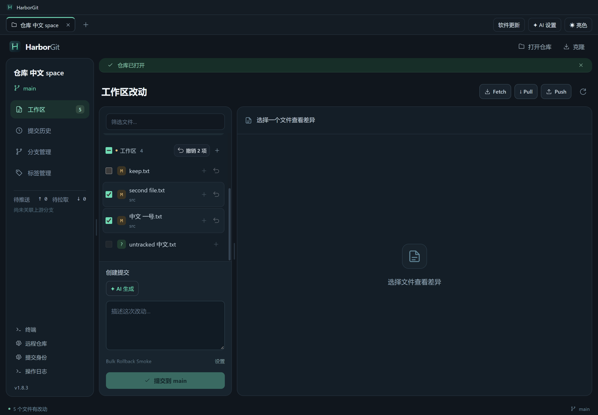
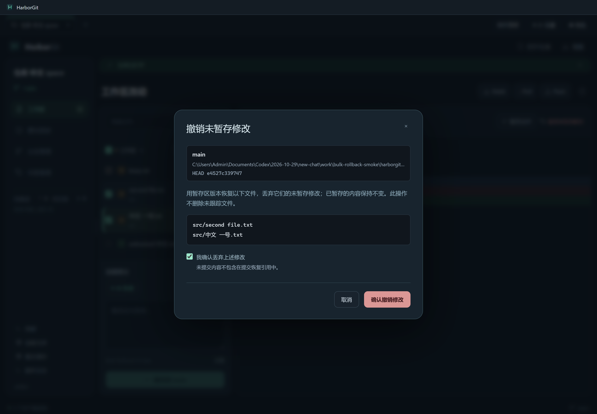
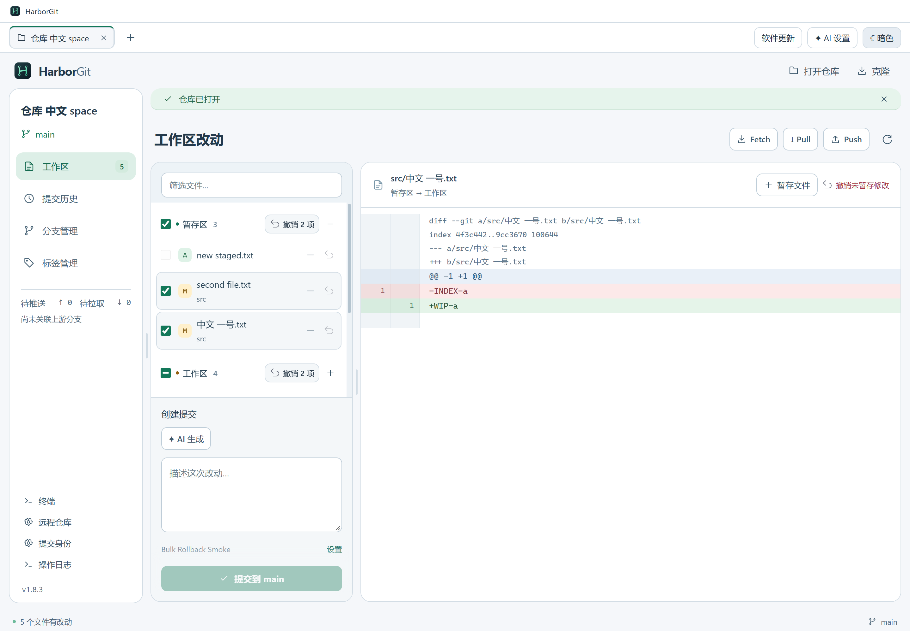

# HarborGit 1.8.3 — 批量选择撤销

后续 [1.8.4](RELEASE-1.8.4.md) 将复选框扩展为通用操作选择：新文件可勾选并暂存；包含不能回滚文件的选择整批禁用撤销。下文记录的是 1.8.3 行为。

在工作区或暂存区勾选多个文件，点击该组标题右侧的 **撤销 N 项**。标题前的复选框可以选择 / 取消选择筛选结果中全部可撤销文件，部分选中时显示半选状态。查看 Diff 不影响勾选；更改筛选文字会清空勾选，避免误操作隐藏文件。

- **工作区**：批量丢弃所选文件的未暂存修改，保留暂存版本。
- **暂存区**：将所选文件的暂存区和工作区一起恢复到 HEAD。

两组独立选择并分别确认，不把不同恢复范围混成一次操作。确认窗口会列出每个路径，只有勾选“确认丢弃所列文件的修改”后才能执行；取消窗口保留全部修改。执行后移除已经不适用的勾选，切换仓库时清空选择。

未跟踪文件、无 HEAD 版本的新文件、冲突文件不参与批量撤销。后端仍检查未跟踪 / 忽略内容碰撞、HEAD 变化、子模块和链接等风险；不支持的批次会在恢复命令执行前拒绝，不自动跳过其中某个文件。

单文件、Diff 和批量入口统一使用本机 IDEA 新界面的回滚图标，提供亮暗两份原始 SVG。来源、许可、已确认事实与推断见 [图标分析](IDEA-ROLLBACK-ICON-ANALYSIS.md)，资源版权说明随安装包分发。







## 验证范围

按要求控制测试范围：执行 TypeScript / 生产构建和一次打包版批量撤销专项场景，没有运行全量 Git、终端、远程或安装卸载回归。

- [构建记录](verification-v1.8.3-build.txt)。
- [专项结果](verification-v1.8.3-bulk-rollback.json)、[原始输出](verification-v1.8.3-bulk-rollback.txt)：中文和空格路径、多选 / 筛选 / 全选半选状态、确认与取消、两个恢复范围、保留未选择文件、新文件和未跟踪文件、亮暗图标。
- [图标与许可打包校验](verification-v1.8.3-icon-assets.json)：ASAR 内的两份 SVG 与两份许可说明均与源码字节一致。
- [Setup 打包](verification-v1.8.3-package.txt)、[更新附件完整性](verification-v1.8.3-update-metadata.json)。

全部写入使用专用测试仓库与隔离应用配置，测试目录已清理；不修改真实仓库、真实应用配置或安装目录，不连接真实远程、不发布 Release。

## 启动与交付

```powershell
npm ci
npm start
npm run dev
npm run dist:setup
```

Windows 安装包为 `release/HarborGit-1.8.3-Setup-x64.exe`，源码与产物哈希见 [交付清单](delivery-manifest-v1.8.3.json)。本版未添加 Shift 连选、跨两种恢复范围的一次性混合撤销或未提交修改的自动备份。

Setup SHA-256：`6628ad3e8ac4ee121e0402cde74f54d1e77c9d744d95680943078fcbd2f881f0`。
