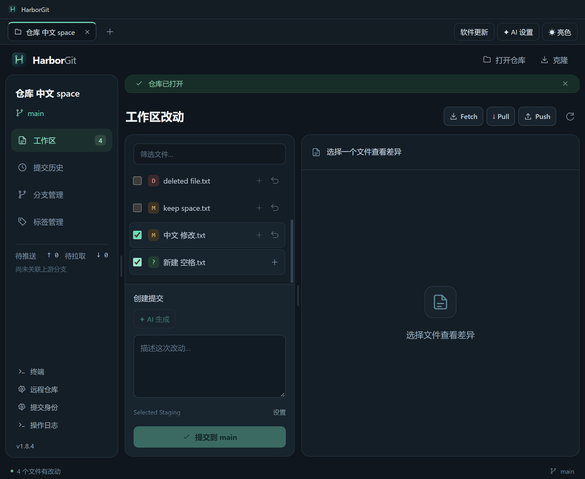

# HarborGit 1.8.4 — 按选择暂存

工作区勾选文件后，组标题右侧的 + 按钮显示 **暂存 N**，只暂存这些文件；悬浮说明和无障碍名称为“暂存所选”。没有勾选时，该按钮仍为“全部暂存”，处理工作区全部非冲突文件。

暂存区对应的 − 按钮采用相同规则：勾选后显示 **取消 N**，只取消这些文件的暂存；未勾选时仍全部取消暂存。工作区和暂存区的勾选分别计算，单个文件行内的 + / − 保持原来的单文件操作。

复选框现在是通用选择，不再仅允许选择可回滚文件：新增和未跟踪文件也可以勾选、全选和暂存。冲突文件继续通过冲突处理入口操作。全选只勾选当前筛选结果；改变筛选文字清空勾选，操作后自动清理已经离开该组的勾选。

批量撤销沿用确认步骤与后端路径保护。若任何勾选项没有可恢复的 HEAD 版本、是未跟踪文件或存在其他撤销限制，则整个撤销按钮禁用并显示原因；不会偷偷撤销其中一部分。暂存操作不受这些仅针对撤销的限制。



## 实现与有限验证

本版只调整 [App.tsx](../src/renderer/App.tsx) 的勾选和目标路径计算，以及 [bulk-selection.css](../src/renderer/bulk-selection.css) 的按钮排版。后端继续使用现有参数数组与 NUL 路径输入，不新增 Git 命令或网络操作。

- [构建记录](verification-v1.8.4-build.txt)：类型检查与生产编译。
- [打包版暂存专项](verification-v1.8.4-selected-staging.json)、[原始输出](verification-v1.8.4-selected-staging.txt)：勾选的中文 / 空格路径和新文件只暂存所选，取消暂存所选保留其余暂存内容，无勾选时的全部操作，删除状态和工作区内容保留，以及包含新文件时禁用批量撤销。
- [Setup 打包](verification-v1.8.4-package.txt)、[更新附件完整性](verification-v1.8.4-update-metadata.json)。

按要求没有运行全量回归或安装卸载测试。所有验证写入均使用专用仓库和隔离配置，测试目录已清理，不操作实际项目或真实远程，也没有覆盖已安装的软件或发布 Release。

## 启动与打包

```powershell
npm ci
npm start
npm run dev
npm run dist:setup
```

安装包：`release/HarborGit-1.8.4-Setup-x64.exe`。源码与产物校验见 [交付清单](delivery-manifest-v1.8.4.json)。本版不增加 Shift 连选或跨两组的一键混合操作。

Setup SHA-256：`85e962d6be976350de47a7a53754951e449c4c2789e9ba9c632a366771a2239c`。
