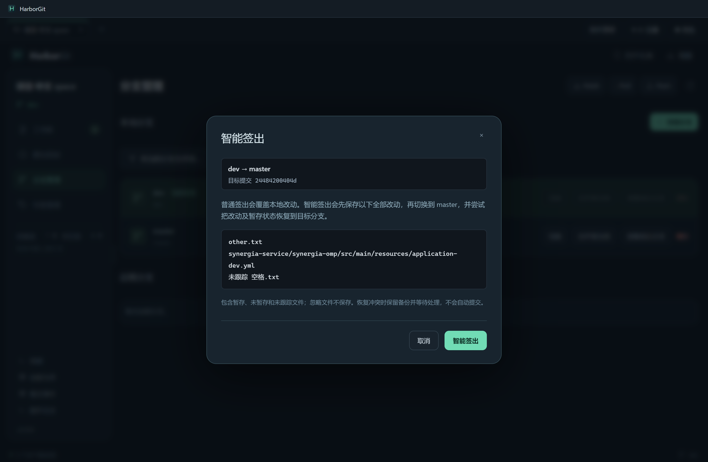
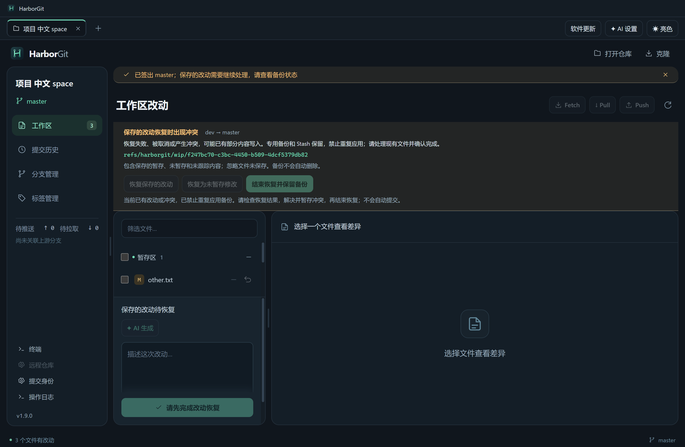

# HarborGit 1.9.0 — 智能签出

在分支管理中点击目标本地分支的“切换”。普通签出可以完成时直接切换；遇到“本地改动会被覆盖”时，展示 **智能签出** 对话框。检查原分支、目标分支和保存文件清单后，点击“智能签出”：

1. 保存当前仓库暂存、未暂存和未跟踪文件，保留原暂存状态的恢复信息。
2. 核对分支与提交并普通签出目标分支，不强制覆盖。
3. 尝试将保存的改动及暂存状态恢复到目标分支。成功后仍是未提交改动，可以继续编辑和提交。

例如 dev → master：恢复成功后，改动在 master 工作区。若希望 dev 改动暂不出现在 master，则应自行保存后暂不恢复；本版智能签出是“携带改动切换”的流程。

## 恢复冲突与中断

恢复冲突和签出失败分别展示。签出成功但恢复冲突时，停留在目标分支并打开工作区视图，通过现有文件冲突入口处理，解决并暂存后点击“结束恢复并保留备份”。这不是变基，不需要执行 rebase --continue。

如保留暂存状态的恢复失败且确认索引和文件没有部分写入，可以选择“恢复为未暂存修改”；存在现有改动 / 冲突时禁止重复应用备份。关闭并重新打开项目后会读取保存记录，展示待恢复状态，程序不会盲目重放。

保存时先持久化唯一标识，再 stash push --include-untracked；确认归属后创建 refs/harborgit/wip/<token> 专用引用。恢复使用固定引用的 stash apply [--index]，不依赖 stash@{0}，也不自动删除 Stash 或 WIP 引用。切换失败时核对实际分支，能安全确定恢复位置时尝试恢复原分支；否则保留备份等待处理。

## 文件与版本保护

- 原分支 / HEAD 或目标提交与确认窗口不一致时拒绝继续。
- 目标已在其他工作区签出时拒绝智能签出。
- 忽略文件不保存，签出前保护与目标路径冲突的忽略内容；与目标重名的未跟踪内容也会阻止智能签出。
- 智能签出暂不支持含子模块、符号链接或特殊文件模式的仓库。无关未跟踪空目录保留。
- 合并、变基、未完成的改动恢复等状态继续受保护。
- 智能签出仅接入已有本地分支切换；远程分支仍通过“基于此创建分支”。没有新增强制签出或 Shelf 机制。

恢复机制复用已有 WIP 实现，保留旧版变基记录读取；新的智能签出记录使用 version=2，避免旧版程序误按变基恢复。记录文件沿用工作树 Git 元数据中的 harborgit-rebase-save.json，字段 kind=checkout、恢复分支与预期提交明确区分用途。待恢复期间不宜降级应用；旧版本会拒绝不认识的记录格式。





## IDEA 分析与自行设计

[IDEA 静态分析](IDEA-SMART-CHECKOUT-ANALYSIS.md) 记录了分析时 1.8.4 的行为，本版补上其中缺少的保存 / 签出 / 恢复流程。IDEA 按设置选择 Shelf / Stash，部分 Stash 入口不包含未跟踪文件；HarborGit 自行实现 stash -u、固定引用 apply、持久记录、重入保护和取消后的恢复位置校验。界面与代码均自行编写，没有复制 IDEA Java 实现。

## 有限验证

- [生产构建](verification-v1.9.0-build.txt)：TypeScript 与生产打包。
- [4 个后端专项场景](verification-v1.9.0-checkout-backend.txt)：暂存 / 未暂存 / 中文未跟踪内容携带到目标，冲突后重开并处理，过期提交及未跟踪 / 忽略碰撞保护，取消任务后保留备份且不重复恢复。
- [目标暂存状态恢复失败后的降级恢复](verification-v1.9.0-checkout-index-recovery.txt)：确认未部分写入后，允许恢复为未暂存改动并进入冲突处理。
- [2 个旧 WIP 场景](verification-v1.9.0-legacy-wip.txt)：复用备份代码后，原暂存 / 未暂存 / 二进制 / 未跟踪恢复和跨源分支变基恢复仍正常。
- [打包版界面专项](verification-v1.9.0-checkout-ui.json)：智能签出弹窗及取消、目标分支恢复冲突、文件处理与结束恢复入口。
- [最终打包内容核对](verification-v1.9.0-final-package.json)：主进程、preload 与 renderer 均与最终生产构建字节一致。
- [Setup 打包](verification-v1.9.0-package.txt)、[更新附件完整性](verification-v1.9.0-update-metadata.json)。

界面专项使用的 renderer 文件哈希与最终重建结果一致，最后调整的恢复判断由单独后端检查验证。没有运行全量回归或安装卸载测试。所有写入都在专用仓库 / 隔离配置中验证，不操作真实项目、真实远程或当前安装目录，也没有发布 GitHub Release。

## 启动与打包

```powershell
npm ci
npm start
npm run dev
npm run dist:setup
```

安装包为 release/HarborGit-1.9.0-Setup-x64.exe。文件哈希见 [交付清单](delivery-manifest-v1.9.0.json)。

Setup SHA-256：`0348ecf7db4ebd418b65b7137645003a2c8b200a187188d41e3c10af0593a2e3`。
