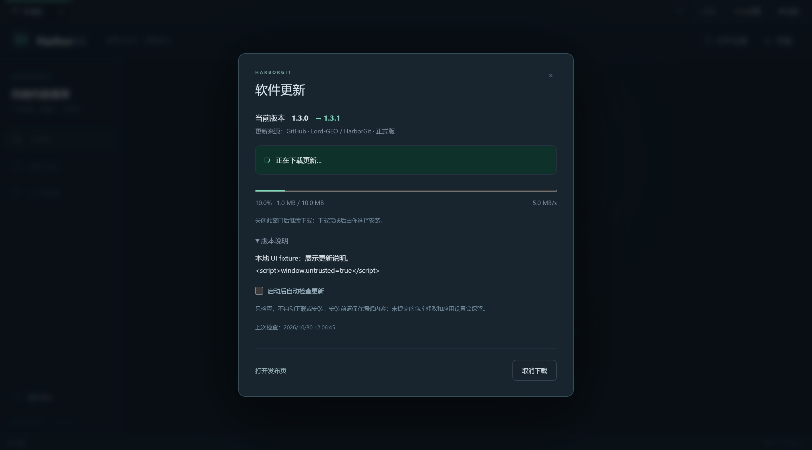
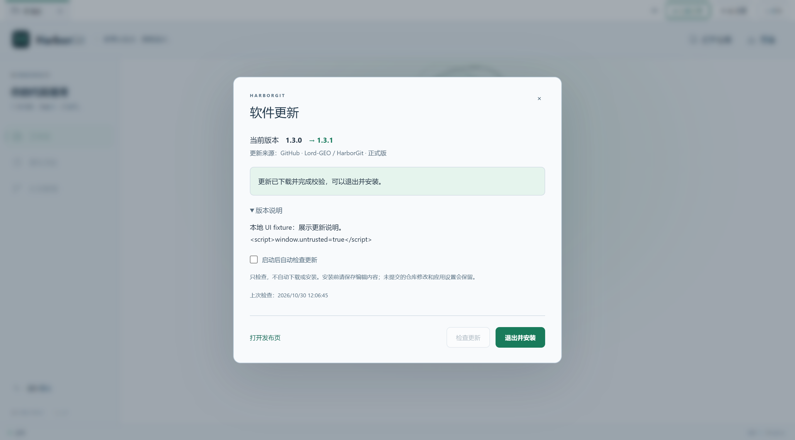

# 应用更新与发布

HarborGit v1.3.0 新增顶部“软件更新”入口。更新来源固定为公开的 [Lord-GEO/HarborGit Releases](https://github.com/Lord-GEO/HarborGit/releases)，采用 electron-updater 的 GitHub provider 与 Windows NSIS 更新方式。

## 用户操作

1. 旧版没有更新代码，需要先关闭应用，手动安装 `HarborGit-1.3.0-Setup-x64.exe`。原配置继续使用。
2. 启动后默认等待 15 秒检查正式版；之后每 6 小时检查，也可以打开“软件更新”手动检查。取消“启动后自动检查更新”可停用后台检查。
3. 有更高版本时显示提示；查看版本说明后点击“下载更新”。支持查看百分比、大小和速度，取消后可重试。关闭更新窗口会继续下载，退出整个应用会停止本次下载。
4. 下载成功并通过 SHA-512 校验后，点击“退出并安装”。应用再次确认，默认选择取消。安装可能显示向导，按提示完成。

普通退出不会自动安装。Git 或 AI 任务仍在运行时会拒绝安装；确认前后均检查任务状态，进入安装阶段后拒绝新仓库操作。未提交的仓库文件和 index 会保留，更新程序不执行 Git 写操作。内存中的提交草稿、尚未保存的冲突编辑需要事先保存。

自动更新仅在 **Windows Setup 已安装版本** 启用。便携版、目录版和开发运行提供“打开发布页”手动下载。当前 macOS 使用 ad-hoc 签名，暂不启用自动安装；macOS 自动更新需要正式签名，见 [electron-builder v26 官方说明](https://www.electron.build/v26/docs/features/auto-update/)。

自动检查设置保存在 `%APPDATA%/HarborGit/update-settings.json`；下载缓存由 electron-updater 管理，默认位于 `%LOCALAPPDATA%/harbor-git-updater`。更新不修改 AI 凭据设置，卸载也保留应用配置。客户端不需要 GitHub Token，不接收 renderer 传入的下载 URL、程序路径或命令。

## 发布下一版本

更新只能发现**更高版本**，例如安装 v1.3.0 后需要发布 v1.3.1 才会提示。不会降级，也不接受预发布版。不要只替换相同版本号的 EXE。

1. 同步修改 `package.json`、`package-lock.json` 顶层及根包的版本号，更新 `release-notes.md`。
2. 在 Windows 执行：

   ```powershell
   npm ci
   npm test
   npm run dist:setup
   npm run verify:updates
   ```

3. 把下列三个文件放入**同一个正式 GitHub Release**（例如标签 `v1.3.1`）：

   | 文件 | 作用 |
   |---|---|
   | `HarborGit-1.3.1-Setup-x64.exe` | 实际安装程序 |
   | `HarborGit-1.3.1-Setup-x64.exe.blockmap` | 差量下载辅助文件 |
   | `latest.yml` | 版本、安装包名称、大小及 SHA-512 |

4. 发布后，使用已安装的较早版本点击检查更新。发布页应处于正式发布状态，非 Draft，版本号与 metadata 一致。不要手工改写散列或把其他构建的 metadata 混入。

`npm run dist:setup` 使用 `--publish never`，本地打包不会上传。`npm run verify:updates` 核对真实 Setup 的大小、SHA-512、blockmap 以及包内 `resources/app-update.yml` 的 GitHub 来源配置。

现有 `.github/workflows/build-desktop.yml` 已增加更新元数据校验与上传。推送匹配版本的 `v` 标签后，工作流构建 Windows/macOS，上传上述 Windows 更新附件及现有 Mac 安装文件；手动触发只生成 Artifacts。当前修改尚未推送，也没有创建新的 GitHub Release。

如 fork 后更换更新源，需要同步修改 `package.json` 中 `build.win.publish`、`src/main/updates.ts` 的固定发布页地址、`SoftwareUpdates.tsx` 的来源文字以及 metadata 校验脚本。请保留原 `appId` 供同一产品正常覆盖升级；独立 fork 产品应设置自己的应用身份。

## 实现

- `src/main/updates.ts`：主进程状态机、自动检查设置、检查超时、下载超时/取消、安装任务保护。
- `src/main/update-engine.ts`：electron-updater 适配，禁止自动下载、普通退出安装、降级、预发布版和 Web 安装器。
- `src/main/main.ts`、`preload.ts`：固定操作 IPC 和 sender 核验、安装确认、固定发布页跳转。没有 renderer 任意文件执行能力。
- `src/renderer/SoftwareUpdates.tsx`：版本、说明、进度、取消/重试及明暗主题。说明按纯文本展示，不执行远程 HTML。
- `package.json`：显式 GitHub 更新源；builder 生成 `app-update.yml`、`latest.yml` 及 blockmap。

检查界面超时为 30 秒，下载上限 15 分钟并会取消实际传输。后台检查错误保留在更新窗口，不打断仓库操作；可重试或打开发布页手动下载。

当前 Windows 包没有代码签名；SHA-512 校验确认文件与 GitHub Release 元数据一致，不代表发布者证书验证。有关配置与事件依据见 [electron-updater API](https://www.electron.build/v26/docs/api/electron-updater.class.appupdater/)。

## 验证范围

- [完整后端回归](verification-v1.3-backend.txt)：34/34 通过，含 9 项更新状态测试，以及现有 Git、AI 与远程管理测试。
- [真实更新下载测试](verification-v1.3-update-runtime.json)：Electron 网络层 + 真实 NsisUpdater 连接 loopback HTTP，验证 metadata、下载/缓存、SHA-512、损坏拒绝、取消后重试、同版本不更新及 404 提示。传输的是 3 MiB 无执行能力的测试字节，**未执行安装器**。
- [更新界面测试](verification-v1.3-update-ui.txt)：2/2 通过，覆盖真实开发/目录版 IPC 拦截，以及真实 renderer/preload/service 搭配测试 engine 的说明、进度、取消、重试、主题和安装保护。截图中的 1.3.1 是本地 fixture，未发布该版本。
- [正式构建的更新附件校验](verification-v1.3-update-metadata.json)：实际 Setup 与 latest.yml 的大小、SHA-512 相符，包内固定更新源正确，blockmap 存在。
- [隔离安装验证](verification-v1.3.0-installer.json)、[安装后 UI](verification-v1.3.0-installed-ui.txt)：采用独立 QA 应用身份，检查安装、已安装更新入口、设置重启恢复、核心 Git 闭环及卸载；应用 EXE 与 ASAR 通过 SHA-256 对照，来自同一正式载荷。测试仅访问隔离配置和新建测试仓库，不执行正式更新下载或安装。

界面首轮测试发现自动检查开关在异步保存期间短暂回跳，已改为即时反馈、保存失败时回退；重跑通过。安装首轮使用独立 QA EXE 名称时被固定卸载器名称判断为目录版，已按当前 EXE 名称查找 NSIS 卸载器，重新打包并完成 2/2 安装后 UI 验证。以上链接均为最终通过结果。

尚未完成真实 GitHub 已发布新版 → 客户端下载 → 覆盖升级的生产端到端验证，因为本次未发布新版。没有测试 macOS 自动更新、多用户管理员升级或正式 Windows 签名验证。既有安装/卸载和下载流程已经分开验证；不把 fixture 的安装请求记录当作实际覆盖升级成功。

复现命令：`npm run test:updates`、`npm run test:updates:runtime`、构建后 `npm run test:ui -- --grep "software updates"`。如需验证真实安装目录，先 `node scripts/prepare-installer-qa.mjs`，再运行 `powershell -NoProfile -ExecutionPolicy Bypass -File scripts/test-installer.ps1`；脚本只操作专用 QA 路径和独立安装身份。




